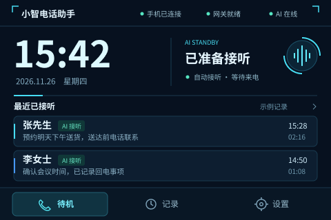
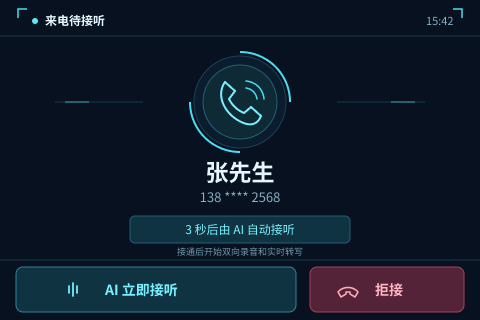
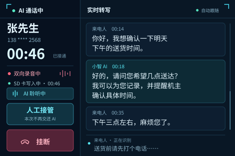
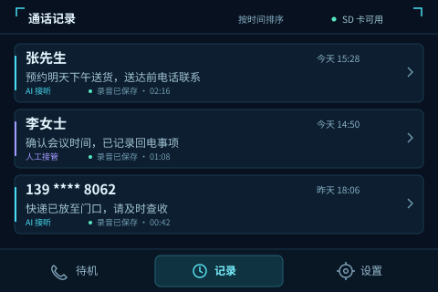
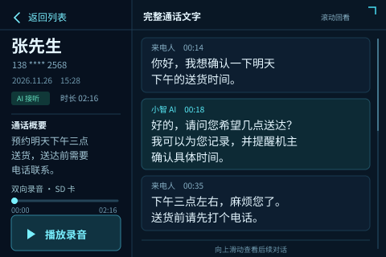
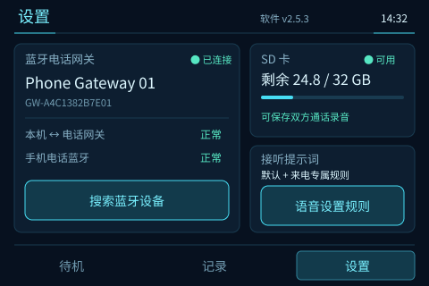
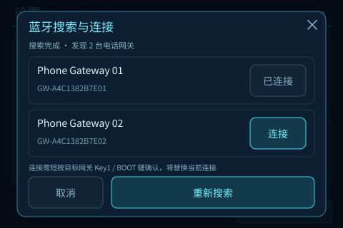
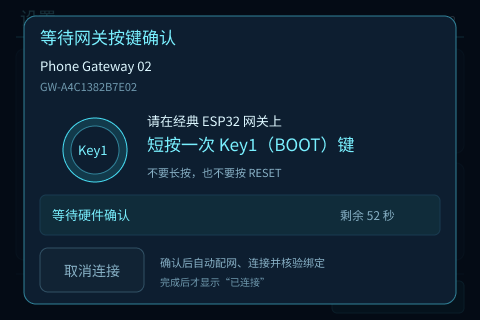
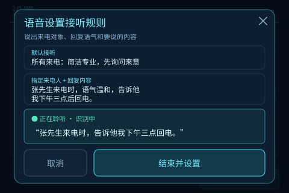

# 小智电话助手 · 最终版界面设计

整理日期：2026-11-26。按本轮确定的版本归档，共 4 类主界面、9 张页面／弹窗视觉稿。目标为 480 × 320 横屏触摸彩屏，采用深蓝背景、青色强调和中文字体的科幻风格。

本目录只包含当前采用的方案，每张图提供 PNG 和 SVG，按使用流程编号。Figma 保留可编辑文字和矢量图层；导出的 SVG 文字可能转为路径。历史稿保留在上级目录。

## 页面清单

| 编号 | 页面／弹窗 | 主要信息及操作 | 矢量文件 | Figma |
| --- | --- | --- | --- | --- |
| 01 | 待机 | 时间日期、手机／网关／AI 状态、自动接听状态、最近已接听电话、导航 | [SVG](01-待机.svg) | [画板](https://www.figma.com/design/PdADkHDgDY4vmJRijnPri6?node-id=1-43) |
| 02 | 来电待接听 | 来电人和号码、自动接听倒计时、AI 立即接听、拒接 | [SVG](02-来电待接听.svg) | [画板](https://www.figma.com/design/PdADkHDgDY4vmJRijnPri6?node-id=3-44) |
| 03 | AI 通话中 | 左侧固定控制与录音状态；右侧独立实时转写；人工接管、挂断 | [SVG](03-AI通话中.svg) | [画板](https://www.figma.com/design/PdADkHDgDY4vmJRijnPri6?node-id=4-120) |
| 04 | 通话记录列表 | 通话对象、时间、时长、一句话概要、接听方式、录音状态 | [SVG](04-通话记录列表.svg) | [画板](https://www.figma.com/design/PdADkHDgDY4vmJRijnPri6?node-id=4-169) |
| 05 | 通话记录详情 | 联系人、概要、完整通话文字、录音播放／暂停和进度 | [SVG](05-通话记录详情.svg) | [画板](https://www.figma.com/design/PdADkHDgDY4vmJRijnPri6?node-id=4-217) |
| 06 | 设置首页 | 网关连接、手机电话蓝牙、SD 卡状态、接听提示词入口、软件版本 | [SVG](06-设置首页.svg) | [画板](https://www.figma.com/design/PdADkHDgDY4vmJRijnPri6?node-id=8-2) |
| 07 | 蓝牙搜索连接 | 设备名、完整 ID、已连接标记、连接、重新搜索、硬件确认提示 | [SVG](07-蓝牙搜索连接.svg) | [画板](https://www.figma.com/design/PdADkHDgDY4vmJRijnPri6?node-id=8-38) |
| 08 | 蓝牙硬件确认 | 目标设备、短按网关 Key1（BOOT）说明、剩余时间、取消连接 | [SVG](08-蓝牙硬件确认.svg) | [画板](https://www.figma.com/design/PdADkHDgDY4vmJRijnPri6?node-id=8-94) |
| 09 | 语音设置接听规则 | 默认和指定来电人的规则示例、语音识别内容、结束并设置、取消 | [SVG](09-语音设置接听规则.svg) | [画板](https://www.figma.com/design/PdADkHDgDY4vmJRijnPri6?node-id=8-148) |

## 页面预览与交互要点

### 01 · 待机

显示最近两通已接听电话，点击进入对应详情；通过底部导航进入记录或设置。无记录与记录读取失败分别显示。

### 02 · 来电待接听

倒计时结束或点击立即接听后进入接听中，实际接通后才开始通话计时、双方录音和实时转写。对方取消时退出待接听状态。

### 03 · AI 通话中

左侧控制区宽 164 像素，右侧转写区宽 316 像素。长转写独立滚动，回看时暂停自动跟随，并提供回到最新入口。双方录音保存到 SD 卡，区分写入中、保存完成和失败。

人工接管前说明本次无法交还 AI；接管后 AI 停止参与，继续显示录音、转写和挂断操作。

### 04 · 通话记录列表

按时间倒序，点击条目进入该次通话详情；长列表滚动，底部导航固定。

### 05 · 通话记录详情

概要、完整转写和录音关联同一次通话。文字独立滚动；录音支持播放、暂停和拖动进度，离开详情后停止播放。录音不可读时显示原因，仍可查看已保存文字。

### 06 · 设置首页

分别表达本机到网关及手机电话蓝牙状态，显示 SD 卡可用性和容量。接听提示词支持默认要求、指定来电人、回复语气及回复内容。软件版本示例为 v2.5.3，实现时读取实际运行固件版本。

### 07 · 蓝牙搜索连接

完整设备 ID 用于辨认目标。切换连接前提示会替换当前连接；需要物理授权的请求进入硬件确认弹窗。

### 08 · 蓝牙硬件确认

短按经典 ESP32 网关的 Key1（BOOT）键确认，S3 无需按键。等待支持取消、超时和断开反馈；确认后继续配网、连接及核验，完成后才标记已连接。已绑定网关经过认证的重新配网流程无需再次按键。详见 [桥接设计 §17](../../designv1/esp32-hfp-s3-realtime-design.md)。

### 09 · 语音设置接听规则

支持“所有来电简洁专业地接听”和“张先生来电时，语气温和，告诉他我下午三点后回电”等语音要求。示例仅供参考。结束输入后整理规则并核对，身份或内容有歧义时澄清；成功后更新生效规则，取消或失败保留原规则。

## 页面流转

| 起点 | 操作／事件 | 去向 |
| --- | --- | --- |
| 待机 | 收到来电 | 来电待接听 → 接听中 → AI 通话中 |
| AI 通话中 | 人工接管并确认 | 人工通话中，本次不交还 AI |
| AI／人工通话中 | 通话结束 | 录音保存反馈 → 待机 |
| 待机／底部导航 | 点击记录 | 记录列表 → 记录详情 → 返回列表 |
| 设置首页 | 搜索蓝牙设备 | 搜索结果 → 连接 → 必要时硬件确认 → 配网与核验 → 连接结果 |
| 设置首页 | 语音设置规则 | 开始输入 → 聆听识别 → 整理核对 → 保存结果 |

## 交付边界与屏幕适配

当前为静态设计归档，示例时间、联系人、内容、容量、版本和倒计时不代表实时设备数据。跳转、滚动、播放、扫描、配对和语音设置尚未实现。

人工接管确认、人工通话中、通话结束保存反馈、语音规则核对及各类空／错误／加载状态已在需求中描述，尚未单独绘制视觉稿，本次不计为已出图页面。其他待确认事项保留在 [界面设计](../界面设计.md)。

后续适配范围为其他 XiaoZhi 触摸彩屏。保留信息优先级和操作语义，按屏幕尺寸调整卡片、转写和滚动区域；窄屏可改为上下布局或分步展示。重要操作保持足够触摸面积，长文字通过换行、滚动或详情查看，不按比例整体缩小。

后续修订同步更新本目录、页面索引和对应 Figma 画板。
