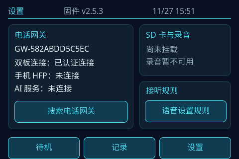
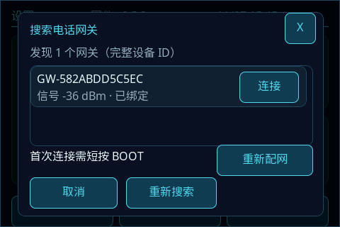
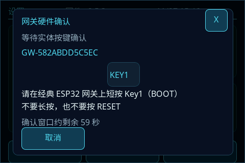
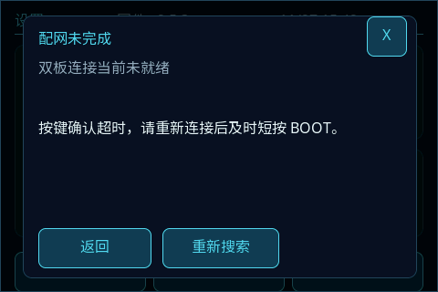

# 阶段三：设置与配网页面实施记录

日期：2026-11-27。范围为 Waveshare ESP32-S3 Touch LCD 3.5B 的 480×320 设置首页（06）、搜索连接（07）和硬件确认（08）。本轮用真实双板、真实 LVGL 点击回调、BLE 安全连接和局域网认证测试；BOOT 操作用调试固件串口命令模拟。物理触摸、物理按键、真正断电和第二路由器验收单列，不用模拟替代。

**当前补验状态（2026-11-28）**：本报告正文保留阶段三当时的结果。主机环境问题已解决，后续 `artifacts/stage4-host-full-41.log` 的 174 项全量测试无跳过通过；不能再把“全量未跑完”描述为当前状态。全新未绑定和换路由器仍缺实机证据，原因是此前验收覆盖遗漏，同网保留绑定恢复不覆盖这两种场景。阶段三整体仍未完成验收；记录限制不等于补验。

## 已实现

- 设置页显示运行固件版本、同步时间、完整绑定 ID、双板认证状态、手机 HFP 状态、AI 会话状态。HFP 只在完整连接状态显示已连接；远端状态过期显示未知。局域网认证及新鲜心跳均满足后才显示双板已连接。
- 搜索页显示完整 ID、RSSI、已绑定标记；支持正在搜索、空结果、重新搜索和错误。最多保留八个设备，列表可以滚动。手机系统电话蓝牙配对仍在手机系统完成。
- 普通连接进入安全 BLE 配网，需要短按网关 Key1／BOOT 确认；已绑定的“重新配网”使用已有认证流程，无需再次按键。不同 ID 的连接先显示替换确认，失败后以真实连接状态为准。
- 等待期间可取消；取消扫描或等待按键不会声称已经撤销发送过的 Wi-Fi。配置已发送后禁用关闭／取消，等待结果；配置完成后仍等待局域网认证，不能将 BLE 连接或发送配置算成功。
- 按键确认有约 60 秒窗口和明确超时提示；BLE 中断、配网错误及等待局域网认证超时有失败页面。取消过程中阻止迟到 BLE 连接继续配置。
- 当前 SD 驱动和录音尚未接入，显示“尚未挂载／录音暂不可用”，不猜测是否插卡或容量。记录、规则入口明确提示分别属于阶段五、六。底部“待机”返回已有语音页面，阶段四的电话待机页面尚未实现。
- 字体从锁定版本组件的 CBIN 生成，只打包本页需要的 300 个字符，位图 27568 字节，存入固件只读区。构建遇到缺字直接失败，无需联网加载字体即可读中文。没有修改管理组件或手工生成文件。

主要源码：`main/boards/waveshare/esp32-s3-touch-lcd-3.5b/phone_settings_view.*`、该板 `custom_lcd_display.*`、`main/gateway_manager.*`、`main/gateway_serial.cc`。UI 保持在本板拥有的层；共享 `Display` 只增加默认无操作的可选调试接口。经理任务发布有界状态快照，UI 不读取 Wi-Fi 密码或绑定密钥。

经典仓库本阶段仅调整 `main/gateway_manager.c` 的离线 Wi-Fi 状态探测顺序，先检查 netif/IP，避免离线每秒约 50 条驱动警告挤占调试日志。该文件原有阶段一、二的未提交修改保留。

## 内存与本轮发现的问题

| 对象 | 实际策略 |
| --- | --- |
| RGB565 截图 | 显式 PSRAM，480×320×2＝307200 字节；离开显示锁后再串口传输，结束释放 |
| 串口 UI 任务栈 | 支持此配置的本板使用 `xTaskCreateWithCaps`，12288 字节 PSRAM |
| LVGL 驱动调用栈 | 内部 10240 字节，原因见下方实机失败记录 |
| LCD 帧缓存 | 保持原有 PSRAM 路径 |
| DMA 传输缓冲、描述符 | 保留驱动要求的能力，不盲目迁到外部 |
| 页面对象 | 一次创建、重复更新，有界八行设备列表，避免刷新时重复构造整页 |

失败证据全部保留：

1. `artifacts/phase3-ui-01/serial-COM3.log`：原 4096 字节文本控制台栈运行 UI 后溢出。已改为上述外部 12 KiB 栈。
2. `artifacts/phase3-ui-02/06-settings.png`：字体资源未加载时中文缺字，已用离线子集字体修复。
3. `artifacts/phase3-provision-01`：配网本身成功，但经典离线警告积压使测试器未及时读到模拟短按标记，整体 FAIL 保留。修复驱动查询顺序及主机串口批量排空，再重新运行。
4. `artifacts/phase3-provision-02`、`artifacts/phase3-freeze-04`：实验性外部 LVGL 栈下，SPI 驱动为栈上的命令参数申请内部 DMA 临时缓冲失败；旧刷新回调等待未提交成功的 DMA，显示锁未释放。改为内部 10 KiB 驱动调用栈，检查提交错误并对完成等待设置上限。组件支持外部栈不代表下游驱动无额外要求。规则已补入 `docs/memory-allocation.md`。
5. `artifacts/phase3-provision-03`：29 项检查通过，但超时画面最初只报告 BLE 断开。进一步给本地按键确认窗口独立超时结果，最终回归要求明确得到 `button_confirmation_timeout`。
6. `artifacts/phase3-provision-04`：最终超时提示与普通短按配网已通过，随后一条经典端 UART 状态 JSON 中 `ble` 字段缺一个引号，主机解码异常，中止时网关 Wi-Fi 正处于清除状态；整体 FAIL 保留。工具现在保留并拒绝损坏帧、清除该来源的旧快照、重新请求；单来源超过三条则失败，不补字或推断状态。随后 `artifacts/phase3-recovery-after-host-error` 用真实页面重新配网，实测 `ready=1,fresh=1`。后续完整回归另存新目录。

## 可重复操作

S3 串口 COM3，115200 波特率；打开设置页可以点击原语音界面右上方“设置”，也可使用：

```text
ui settings
ui status
ui controls
ui click search
ui click connect 0
ui click cancel
ui click rescan
ui click reprovision
ui click close
ui click home
ui screenshot
```

`ui click` 发送同一 LVGL 按钮事件；隐藏、禁用或被弹窗遮挡的按钮会拒绝。`ui status` 包含页码、扫描／配网／认证状态、错误和 LVGL 栈余量；随后输出内部 free/minimum/largest 与 PSRAM free/largest。页码：0 原语音界面、1 设置、2 搜索、3 替换确认、4 配网进度、5 结果、6 功能说明。

截图为设备实际 LVGL RGB565 渲染，通过带长度、偏移与 FNV 校验的串口帧导出；不是设计稿或主机重画。它能验证固件渲染，不能证明 LCD 实际亮度、面板色彩或触摸命中。

```powershell
& 'C:/Espressif/tools/python/python.exe' tools/phone_ui_capture.py --output artifacts/ui-check --command 'ui settings' --command 'ui controls' --screenshot settings.png
```

两板配网回归需要经典调试构建 `CONFIG_GATEWAY_DEBUG_COMMANDS=y`；短按／长按分别调用其真实处理分支，长按清除网关 Wi-Fi、保留绑定，测试随后通过真实页面恢复。**正式固件不启用模拟按键命令**。不要在普通电话测试中误用长按清网命令。

```powershell
& 'C:/Espressif/tools/python/python.exe' tools/phone_ui_bench.py --output artifacts/ui-provision-new --timeout-test
& 'C:/Espressif/tools/python/python.exe' tools/phone_ui_bench.py --output artifacts/ui-navigation-new --navigation-only
```

这两条是会操作设备的验收命令，第一条会暂时清除经典 Wi-Fi 并恢复。目录使用新名称，避免覆盖旧证据。账号、密钥、Wi-Fi 和当前绑定不写入报告；原有私人 NVS 备份留在忽略的 artifacts 目录，不提交。

## 结果及交付状态

此前通过的截图已经实看并修正底部按钮越界一像素、搜索提示换行裁切及中文缺字。

| 项目 | 结果与证据 |
| --- | --- |
| 最终普通配网、取消、恢复配网 | `artifacts/phase3-provision-05/report.json`：24 项全 PASS，最终两板在线；本轮状态损坏帧拒绝数 S3／经典均为 0 |
| 明确的按键确认超时 | 最终同一固件 `phase3-provision-04` 的 `button_timeout_is_failure` PASS，错误为 `button_confirmation_timeout`；该轮后续主机串口解析 FAIL 不改写 |
| 空结果、重试、遮挡、重复页面 | `artifacts/phase3-navigation-01/report.json`：11 项 PASS，含十轮设置／规则／记录／返回／待机切换；在超时文案细化前的同一布局版本执行 |
| 设置、搜索、硬件确认与超时画面 | 实际截图归档到本目录 `phase3-ui-20261127/`，逐张查看中文、完整 ID、裁切、说明与真实状态 |
| 按钮触摸目标 | 所报可见按钮高度至少 44 px；设置页按钮坐标全部处于 480×320 内。实际触摸面板点击尚未测 |
| 正式配置启动恢复 | `artifacts/phase3-production-startup/summary.json`：10 项全 PASS，包含初始连接、S3 两次软件重启、经典一次软件重启和六次间隔十秒的心跳检查。每次重新认证，mDNS failures 为 0，未出现非预期重启 |

最终配网轮 S3 观测到的内部 free 最低 13415 字节、内部历史 minimum 8768 字节、largest 最低 7680 字节；PSRAM free 最低 5882416 字节、largest 最低 5767168 字节。LVGL 栈高水位最少剩余 4012 字节，串口任务最少剩余 5956 字节。此表覆盖配网与页面控制负载，不认证通话／云端同时工作时的余量。









构建来源：本机 ESP-IDF v6.1（`idf.py --version` 已核对，当前为 detached HEAD），SDK commit `fff9895c82d744c7237be8847347bdd1b07c6643`。两库基于 `0011b3a4`（S3）和 `3942511`（经典）的当前工作区，含原有阶段一／二改动；未声称这些基础提交已包含本阶段修改。

| 最终镜像 | 构建路径／SHA-256 | 烧录证据 |
| --- | --- | --- |
| S3，USB COM3，Waveshare 3.5B，UDP | `build/xiaozhi.bin`；`32a7abe3e10a02f06d37e2bf16ea17a50c1b7444382fcfd88209a2005e1ee0e2` | `artifacts/phase3-flash-06.log`：Hash verified、Done；应用分区剩余约 24% |
| 经典 ESP32，COM5，正式 UDP／PSRAM 配置 | `D:\work\Bluetooth-gateway\build-uart-provision\esp32_hfp_gateway.bin`；`684d2172b6d9c6fb1e8af942d95421825c17f5115786eb3245256899fcac126e` | 经典仓库 `artifacts/phase3-production-flash.log`：Hash verified、Done；生成配置中 `CONFIG_GATEWAY_DEBUG_COMMANDS` 关闭，目录名中的 uart 不代表当前使用 UART |

构建和烧录没有擦除 NVS。普通确认配网会按现有协议生成并一致保存新的绑定材料，完成后不回写旧备份，以免两端不同步。

正式经典固件启动日志实测 `debug_buttons=0`，重新探测到 8 MB PSRAM，4 MB 映射到 heap；S3 日志确认 LVGL 内部栈 `bytes=10240,caps=2052`，mDNS 栈使用 SPIRAM。收尾 `artifacts/phase3-final-state` 再通过页面状态和截图确认：设置页 `ready=1,fresh=1,error=`，内部 free 14939、minimum 9052、largest 7680，PSRAM free 5891060、largest 5767168 字节。此时 LVGL 栈剩余 4844、截图后串口栈剩余 7044 字节；重启后的历史 minimum 与上文配网压力轮分开记录。

收尾屏幕留在设置页，两板 Wi-Fi 与绑定保留，USB 日志工具已经关闭端口；经典模拟按键命令关闭。当前手机 HFP 显示未连接与双板已认证并不矛盾，手机系统电话蓝牙是独立连接。

后续人工物理验收可从原语音页右上“设置”入口开始：已连接环境先查看状态；需要重做普通授权时，在经典板上长按 BOOT 约三秒清除其 Wi-Fi，等待设置页如实失联，再搜索、选择完整 ID，在确认窗口内短按 BOOT。另验证“重新配网”恢复、实际触摸取消、两板断电重上及更换路由器。上述人工步骤尚未执行，不纳入本轮 PASS。

主机与构建验证：

- `artifacts/phase3-ui-tests-final.log`：9 项通过，含损坏截图帧拒绝、离线中文字库覆盖及既有 PCM／ADPCM 辅助函数测试；无跳过。
- `artifacts/phase3-relevant-tests-utf8.log`：24 项执行成功，其中 16 项因缺少普通 host C++ 编译器而跳过。首次未设置 Python UTF-8 模式导致的 Windows GBK 解码错误保留在 `phase3-relevant-tests-final.log`，使用 `PYTHONUTF8=1` 后通过。
- 经典仓库 `artifacts/phase3-host-tests-native.log`：配置 Zig 原生 C 编译器后 56 项全部通过，无跳过。
- S3 全量主机套件尝试未完成：`phase3-host-tests.log` 存在 Windows 临时目录清理错误；`phase3-host-tests-02.log` 执行到构建／CI 文件扫描后超时退出，没有完整 unittest 汇总，不能记全量通过。本次没有修改无关主机测试来掩盖环境问题。
- 两端触及的 C/C++ 文件通过各仓库 clang-format 检查，`git diff --check` 无空白错误。S3 本板与经典 UDP 配网配置完成实际构建；其他芯片／板型没有本轮构建结果。

## 验收边界

2026-11-27 补验说明：全新未绑定设备与跨 SSID／换路由器没有完整实机证据，是此前测试覆盖遗漏；保留绑定的清网恢复和同 SSID 重配不能替代它们。此前记录限制并不意味着已完成这两项。主机套件的环境缺口现已补齐，`artifacts/stage4-host-full-16.log` 实际执行 169 项全部通过、无跳过；这只补齐软件套件，不能回填缺少的设备验收结果。

- 本轮验证真实网络与真实认证，没有向 UI 注入成功状态。模拟 BOOT 只能证明处理流程，不等同于 GPIO 去抖、物理短按／长按或电源稳定性。
- 未清空现有绑定来伪造出厂设备；普通连接确实走非恢复授权路径、短按确认并重新交换绑定，但“全新未绑定设备”的完整出厂状态仍需专项覆盖。
- 只有一台经典网关和当前路由器，未做第二网关替换、跨 SSID 环境变更及真正断电；替换提示的代码路径已实现，不能记作这些实机场景通过。
- 手机 HFP 已连接和 AI 会话中状态依据真实接口显示，本轮主要在 HFP 未连接／AI 未连接条件下运行，未新增通话中页面压力验收。
- 尚未完成人手触摸点击与物理 BOOT 操作。用户可在本轮收尾的已连接环境下继续体验；物理验收完成前，阶段三“完全脱离串口”的最终产品验收保留待确认。
- 此报告不改变阶段一的无线语音、声学验证或阶段四 AI 电话闭环结论。页面成功、配网成功和计数前进均不能认证电话双向清晰语音。
