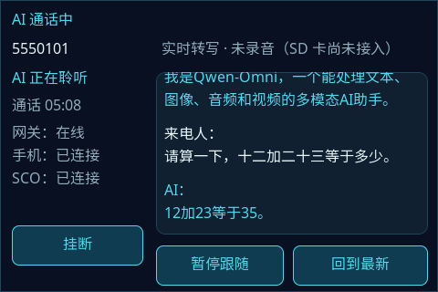

# 阶段四：电话与阿里 AI 实机验收

**当前结论（2026-11-28）**：固定 TLS 缓存基线曾通过 Android 本地 Telecom／真实 HFP/SCO／阿里直连的 302 秒、10 轮数字会话；后续故障提示回归又捕获自发控制失联，以及失联被正常挂断清理覆盖的竞态，不能把此前一次成功当作已稳定。竞态修复和经典端失联期间禁止自动接听的候选均已构建、烧录；S3 最新 180 项、经典 56 项主机测试全部无跳过通过，但 Android USB 调试持续离线，尚未完成当前组合的电话回归。整段录音 ASR 存在差异，完整音质／声学及运营商来电仍未验收，阶段四整体仍未通过。全新未绑定／更换路由器属于阶段三覆盖遗漏，尚无补验结果。历史成功、失败与最新候选分别见文末，不相互覆盖。

日期：2026-11-27。S3 使用 `build-stage4-ai` build-08，经典网关使用当前 COM5 固件。Android 为 Huawei ATU-AL10（Android 8），通过本地 managed Telecom `ConnectionService` 建立 HFP/SCO；这不是运营商 SIM 电话。

本轮覆盖来电、约 3 秒自动接听、SCO 16 kHz、HFP→UDP→S3→阿里 Realtime 上行、阿里回复→S3→UDP→HFP 下行、页面状态与转写、挂断清理、5 分钟多轮负载、内存观察和直连配置回归。代理路径使用 PC `192.168.5.21:7321`，测试后已恢复原始 `websocket_url=""`、debug 地址 `tcp://192.168.5.17:7319`，API key 保留且未输出。

| 项目 | 结果 | 证据/限制 |
|---|---|---|
| 固件构建、烧录 | PASS | `stage4-build-08.log`、`stage4-flash-08.log`，写入 hash verified |
| 主机测试 | PASS（169 项全部通过，无跳过） | 补齐真实 cJSON、mbedTLS 头文件和 Zig C++23 后重跑：`artifacts/stage4-host-full-16.log`，243.617 秒；含 MCP 的 4 项及新增会话连续性 5 项 |
| 启动、SNTP、mDNS、网关握手 | PASS | `stage4-live-08/09`；无 panic/assert/Malloc failed |
| Android 自动接听、SCO | PASS（代理） | `stage4-final-300-09/bench.jsonl`；SCO 16 kHz |
| AI 多轮电话 | PASS（代理） | 300 秒、10 轮已知问题；S3 页面显示 16 条最终转写 |
| 手机接收语音 ASR | PASS（可懂度证据） | `stage4-final-300-09/asr/result.json`；315.28 秒录音重复识别“12 加 23 等于 35” |
| 挂断与旧媒体清理 | PASS | `worker_stopped reason=call_ended`，结束后 AI 回到 Ready |
| 5 分钟稳定性 | PASS（代理传输/云会话范围） | 300 秒，上行 12245 包、failed=0；无崩溃 |
| 5 分钟自然听感 | NOT_FULLY_VERIFIED | 有手机 WAV/ASR 证据，仍需人工听感、回声和双讲确认 |
| 原始阿里直连 | FAIL（两次复现） | 恢复 `websocket_url=""` 后均可 TLS 握手并上传，约 7 秒出现 `esp-tls-mbedtls read error -0x0084`，worker 以 `cloud_disconnected` 退出；记录于 `stage4-live-09` 和 `stage4-live-10` |
| 运营商真实电话 | NOT_RUN | Android 测试为本地 Telecom |
| 微信等 VoIP | NOT_RUN | 需按应用/手机版本单独验证 |

300 秒代理通话中观察到真实无线统计：`udp_rx_late=197`、`jitter_overrun_events=20`、`jitter_discarded_packets=17`、`jitter_skipped_samples=3800`。手机录音仍可被 ASR 连续识别；这些计数不应被抹成“完全无损”。经典端 `sco_stat_valid=false`，`hci_recovered` 不能代替控制器坏帧率。

本轮修复了 NVS/flash 读取的内部栈约束、电话与普通 PCM 队列争用、媒体 generation 切换时旧 ring 清理、控制心跳迟到误判挂断、通知抢占电话和 AI 缓冲分配失败状态。页面显示真实 AI 状态、SCO/网关状态、号码、计时和最多 16 条最终转写，录音明确显示 SD 尚未接入。

此前未完整验收的原因是把代理云会话、短语音、包计数和真实运营商电话混成一个结论。本报告将代理与直连、数字证据与声学听感、本地 Telecom 与运营商电话分开登记。因此当前结论是“代理路径实机通过，阶段四整体未通过”：直连仍失败，运营商/微信和完整自然听感尚未完成，阶段一声学也仍 BLOCKED。

产物：`artifacts/stage4-live-08/serial-COM3.jsonl`、`serial-COM5.jsonl`、`artifacts/stage4-final-300-09/phone/{uplink.wav,downlink.pcm,events.jsonl}`、`artifacts/stage4-final-300-09/asr/result.json`、`artifacts/stage4-live-09/serial-COM3.jsonl`。

## 后续直连复测与未通过项

补充记录不覆盖上面的历史失败。原始 TLS 错误已有更具体证据：`esp-aes: Failed to allocate memory`、`esp-tls-mbedtls: read error -0x0084`。即使 TLS 主工作内存已外置，硬件 AES 仍可能需要内部 DMA 临时缓冲。板级配置关闭硬件 AES，保留正常 16384 字节 TLS 入站 record 缓冲，并通过 canonical 构建核对有效配置后烧录。不能仅将配置写入 JSON 就声称已生效，也不能把减小接收 record 导致的 `-0x0087` 当作远端主动断开。

| 测试 | 结果 | 实际证据 |
| --- | --- | --- |
| 软件 AES 直连短通话 | 数字闭环 PASS | `stage4-direct-nodelay-17-short/result.json`：1 个云会话、1 个问题转写、1 个完整回复，挂断恢复 `ai=1`；不是运营商或声学验收 |
| 首次直连 300 秒 | FAIL | `stage4-direct-sw-aes-15-300/continuity-audit.json`：10 问、10 次转写、9 次完整回复；控制接收约 6.2 秒超时，云会话重开，不能以最终恢复待机放行 |
| 双端 TCP_NODELAY 后 300 秒 | FAIL | `stage4-direct-nodelay-18-300/result.json`：控制连接仍反复超时，4 个云会话、4 问、2 次完整输入转写、1 次完整回复；后段 S3 异常重启 |
| S3 重启定位 | 待定位 | `stage4-live-16/serial-COM3.jsonl`：`LoadProhibited`，回溯到 `tlsf_walk_pool → multi_heap_get_info_impl → heap_caps_get_largest_free_block → ConsoleTask`；提示堆元数据损坏的可能，统计函数不等于损坏来源 |

TCP_NODELAY 仅为待验证的延迟改善，第二轮失败已经证明它不能单独解决本故障。未延长心跳超时来掩盖断流。后续使用现有 ADPCM overlay 减少经典端媒体流量作对照，并用轻量堆保护捕获更早的内存错误，均须重新实测。

验收工具 `tools/phone_ai_validation.py` 按每通电话的主机时间边界审查日志，检查单一云会话、非预期 worker 退出／控制失联／panic、完整输入和回复数量。已对原失败记录回放，能正确判 FAIL。`tools/phone_ai_bench.py` 加入 HFP 和认证就绪预检、通话中失联立即失败、最后回复排空检查、失败时挂断并拉取手机录音。`DIGITAL_PATH_PASS` 仅表示数字会话检查通过，人工自然听感、回声／双讲及运营商通话字段单独保留未验证状态。

ASR 当前 AI 回复是动态文本，不能拿历史固定语料作字符错误率基准。此前 `stage4-direct-sw-aes-15-300/asr-uplink/result.json` 引用的旧 reference 与本轮内容不匹配，其 CER 不参与验收；识别内容仅作为可懂度线索。后续应使用同一轮云端最终回复与手机录音逐轮对照。

## 2026-11-28 补测：覆盖遗漏、状态延迟与经典编码器崩溃

全新未绑定设备、跨 SSID／换路由器是此前验收覆盖遗漏，保留绑定的同网恢复不能替代它们。记录 NOT_RUN 仅说明缺口，不能作为阶段三完整验收通过的依据；目前没有补做这两项的实机证据。应先制定保留现有配置的可恢复测试方案，分别保留初始未绑定、首次授权、网络切换和再次上电自动发现的独立记录。物理 BOOT、触摸及实际断电仍与串口模拟分开验收。

主机套件此前失败涉及 Windows 临时目录、C++ 编译依赖和环境配置，不能直接跳过后报告完整通过。历史 `stage4-host-full-16.log` 为 169 项无跳过；本轮新增测试后，`stage4-host-full-36.log` 实际执行 **172 项、217.174 秒、无跳过、全部通过**。此前 `stage4-host-full-34.log` 的 MCP 类级跳过和 `stage4-host-full-35.log` 的两项资源依赖跳过均保留，最终完整轮不使用它们充数。随后新增经典崩溃判定回归的两项，`stage4-peer-crash-tests-37.log` 的 9 项会话审查测试全部通过；不将该子集称为更新后全量套件结果。

`stage4-diagnose-34` 证明 S3 的 `fresh=0,hfp=0` 不能独立证明蓝牙已断：同一时刻经典直接状态仍为 `connection=3,audio=3,call_active=true`，两向 UDP 继续增长，数秒后 S3 状态恢复，同一云会话完成回复。旧测试器快速停止 Android 媒体后出现的 SCO 断开不能倒置为故障原因。测试器现在先保存失败后状态、Android 日志，再标注每个清理动作时间。

本板 Wi-Fi 配置对照通过维护的 `config.json` 设置静态 TX/RX=6/6、动态 RX=32、RX BA window=6，保留 PSRAM/lwIP 分配和软件 AES。两端新增超过一秒的控制传输耗时日志；没有延长 2 秒状态新鲜度或 6 秒传输超时来掩盖问题。canonical S3 `build/xiaozhi.bin` 的 SHA-256 为 `ef7d6e98f52ec2be6f32da1f39cabc5645106b347f68c506f53ee5648ff453e3`，经典 `build-provision-psram/esp32_hfp_gateway.bin` 为 `c607e84d5d8dd9056493228c240bedc76237faa7c0edded62ea36e9544bb2e34`。烧录校验分别见 `stage4-wifi-budget-flash-35.log` 和经典仓库 `stage4-control-diag-flash-35.log`，均 Hash verified，保留 NVS。阿里 URL 仍为空，即设备直接连接云端；`/api/test/stats` 在本固件返回 404，电话模式依据源码 `kListeningModeAutoStop` 和 PHONE_AI 日志确认为半双工，不能声称该 HTTP 接口已核对模式。

| 当前固件测试 | 结果 | 证据 |
| --- | --- | --- |
| Android 40 秒直连 | DIGITAL_PATH_PASS | `stage4-short-35/result.json`，1 输入、1 完整回复、1 云会话，挂断恢复 Ready；手机接收 WAV 的本轮 ASR 能识别主体内容，专有名称等仍有识别差异 |
| Android 300 秒目标 | **FAIL，未跑满** | `stage4-300-36/result.json`；完成 7 输入／7 回复后，媒体测试约 207 秒处经典端异常，S3 随后媒体超时和控制重连；未等测试器清理就已崩溃 |
| 经典崩溃定位 | 已定位调用链，根因待证实 | 同轮 COM5：`StoreProhibited → SbcAnalysisFilter8 → SBC_Encoder → esp_sbc_enc_process → encode_msbc → codec_task`；故障 ELF SHA-256 `d8765860f317293004ad7504a573d28ce23f13fb7f53ca1805407f8daddb03ea` |

故障日志为 `stage4-live-35/serial-COM5.jsonl`，故障前最后直接状态仍为 HFP/SCO=3、内部 free=15883、largest=14336，不能仅因调用栈在编码器就宣称内存不足、坏帧或编译器为根因。匹配的经典 ELF/bin/map/sdkconfig 已冻结到经典仓库 `artifacts/stage4-failed-firmware-36/`，后续重建不得用新 ELF 解旧故障。

会话测试器新增同轮 COM5 独立日志审查：经典端 panic／重启／护栏失败，即使 S3 在两次轮询之间恢复，也判 FAIL；结束后重连不覆盖失败。当前继续以源码编码器作隔离对照，构建成功、输出自检、已烧录、短测、300 秒稳定性须逐项记录。**阶段四当前仍未通过，不通知用户按已验收效果测试。**

## 2026-11-28 后续：编码器对照与云故障恢复

经典端源码编码器对照已构建、烧录并通过 64 帧连续输入逐字节一致性自检。当前经典应用 SHA-256 为 `70fbd76c52ceb58f6b69ad480107be7928f0591d320c64573ae2e97f901216dd`，自检和启动见 `stage4-live-37/serial-COM5.jsonl`。这只替换编码路径；不能称整个编解码器或 5 分钟长稳已经通过。经典源码与构建约束见其 `docs/sbc-filter-diagnostics.md`。

实测另发现旧 AI 失败状态会每秒关闭自动接听，导致随后来电一直响铃；`stage4-source-short-38/39` 均未实际接听，不能用这两轮评价新编码器语音。S3 增加恢复条件：认证电话状态已结束／空闲、本次通话已停止且云 worker 已退出时才清除 Failed，并恢复它此前压制的自动接听。构建 `stage4-recovery-build-40.log` 成功；实际新镜像烧录证据是 `stage4-recovery-flash-40b.log`（40 是误提前烧录的旧镜像，不计入新修复验证）。新 S3 应用 SHA-256 为 `122b10ad39d9cfb10b4e073ebc5a2a624610814a71f5fe77bcd63fbdda3e6d55`。

| 测试 | 结果 | 证据与边界 |
| --- | --- | --- |
| 修复后主机全量 | PASS | `stage4-host-full-41.log`：174 项、224.580 秒、无跳过；不是设备／声学验收 |
| 新编码器＋恢复修复 40 秒直连 | DIGITAL_PATH_PASS | `stage4-source-short-41/result.json`：1 输入、1 完整回复、1 云会话；本轮手机 ASR 识别出主体内容，名称有差异 |
| 下一轮 300 秒目标 | FAIL，未跑满 | `stage4-source-300-42/result.json`：第一轮回复途中 TLS `-0x7200`／`-29184`，1 输入、0 完整回复；没有经典崩溃证据，不能因此放行其长稳 |
| 真实云故障后恢复 | PASS（该故障场景） | 同一 `stage4-live-40`：挂断后 `failure_cleared`，AUTO_ON 成功；随后 `stage4-after-failure-short-43` 不重启双板完成下一通 1 输入／1 完整回复／1 云会话 |

TLS `-0x7200` 对应本 SDK 的 `MBEDTLS_ERR_SSL_INVALID_RECORD`，不是足以单独认定路由器丢包、内存不足或手机故障的证据。源码审查发现动态接收缓存与非阻塞半截读取需要隔离验证。板级维护配置新增 `CONFIG_MBEDTLS_DYNAMIC_BUFFER=n`，保持外部内存分配与入站 16384／出站 4096 字节固定缓存；不修改 SDK／managed components，不缩小接收上限或延长超时。修复前匹配固件冻结于 `artifacts/stage4-tls-failed-firmware-42`。此配置对照正在构建，不能据此预先声称 TLS 根因已证明或故障已修复。

## 2026-11-28 固定 TLS 缓存复测

上述配置对照随后构建成功（`stage4-static-tls-build-43.log`）并完成应用分区烧录、Hash verified（`stage4-static-tls-flash-43.log`）。实际 S3 应用 SHA-256 为 `c5b5b81190a30d277dc24774ce8d95ea9333d51f04a6fd1db698a2683563625d`，大小 3138368 字节，最小 app 分区剩余约 24%。有效生成配置明确关闭动态 TLS 缓存，保留 `MBEDTLS_EXTERNAL_MEM_ALLOC`、IN=16384、OUT=4096。经典仍是上节的源码编码器固件 `70fbd76c…`，解码滤波替换选项仍关闭。两个匹配固件及配置分别冻结于 S3 `stage4-static-firmware-43` 与经典 `stage4-source-current-firmware-43`；前者 `manifest.json` 记录完整哈希及 SDK 提交。

阿里仍直接连接，`websocket_url=""`、`api_key_set=true`；不是代理对照。两向音频使用 16 kHz HFP/SCO，电话 AI 为首版半双工自动轮次，不验收全双工插话。

| 项目 | 结果 | 证据 |
| --- | --- | --- |
| 新固件 40 秒直连 | DIGITAL_PATH_PASS | `stage4-static-short-44/result.json`：1 输入／1 回复／1 云会话，挂断回 Ready |
| 5 分钟多轮直连 | DIGITAL_PATH_PASS | `stage4-static-300-45/result.json`：实际负载 302.047 秒、10 问／10 输入转写／10 完整回复、1 云会话；双板日志无 panic、重启、分配失败或非预期 worker 退出 |
| 挂断清理 | PASS（本地 Telecom） | 同轮 `worker_stopped reason=call_ended`，上传 12410 包、failed=0；界面恢复 `ai=1` |
| 同一启动周期断网恢复 | PASS（故障注入范围） | `stage4-network-recovery-46/result.json`：实际 `wifi off` 后媒体停止／Failed；离线结束电话、`wifi on` 后重新认证并恢复自动接听；下一通 40 秒完成问答，无任一板重启 |
| 页面实拍式帧缓存截图 | 已核对 | `stage4-static-300-45/active.png`，真实 LCD 帧缓存 CRC 校验；副本见下图。显示号码、约 5 分钟计时、网关／手机／SCO 在线、独立转写区和挂断；如实显示 SD 未接入 |
| 主机全量 | PASS | `stage4-host-full-41.log`：174 项、224.580 秒、无跳过；C++ 格式检查与 Python 工具语法检查另已通过，不用它们替代实机 |
| 录音 ASR | 已完成，音质不放行 | `stage4-static-300-45/asr/result.json`：315.96 秒；与同轮最终 AI 文本对照，205 个规范化字符、44 次编辑、差异 21.46%，不能称为无线丢字率 |

无线统计见 `stage4-static-300-45/transport-metrics.json`，以同一经典端累计计数快照求差，包含会话起始，最后快照早于挂断约 0.76 秒：UDP 收到 15111 包，接受 14889、迟到 222（约 1.469%）、普通拒包 0、越窗 0、发送错误 0；抖动过载／跳样峰值均为 0。HFP 回调 `raw_frames=41365`、`raw_bad=3996`（约 9.660%）、raw queue drop=59、codec_errors=0。`sco_stat_valid=false`，回调标记不能充当控制器空口丢包率。S3 收包日志末端累计 `gaps=24, plc_packets=24, rebuffers=0, queue_drops=0, max_gap_ms=159`；不同端点快照时刻不一致，不用收发总量差拼出假的精确丢包率。

负载采样中经典内部 free 最低 15123、largest 最低 13824 字节；S3 内部 free 快照最低 10919、largest 最低 3060 字节，PSRAM free 最低 3261280 字节；S3 启动以来内部历史最低约 5868 字节。没有持续下降／分配失败，不等于内部 SRAM 余量充裕。根据 Android 同一单调时钟，按参考 PCM 名义结束到两个连续 100 ms、RMS>200 的回录窗口估算，回复等待约 1.600–2.156 秒，中位 1.784 秒（`reply-latency-estimate.json`）。它包含 VAD、云推理和传输，未校准硬件播放尾部，不是声学单程时延。

同轮原始文本基准保存在 `same-call-reference.json`，ASR 对照见 `asr/same-call-comparison.json`。来电人的 10 次输入均转写为本轮固定问题；手机收到的 ASR 包含五轮介绍、五轮算术结果，但英文名称被多次识别为中文音译，另有“图像”“助手”和“等于”等差异。不能将全部 21.46% 归因于蓝牙／UDP，也不能剔除差异后称语音准确率通过。必须补录**同一通话的原始云端回复音频**，用同一 ASR 对照手机回录，再结合听感评价。

本机现有诊断地址保存为 `tcp://192.168.5.17:7319`，当前 PC 地址为 `192.168.5.21`，因此本轮没有完整原始云 PCM 基线。补采所需的“启动独立采集服务、临时修改诊断地址、重启”组合操作被自动审批拒绝，仅返回 `blocked by policy`，未提供具体原因，整条命令未执行。只读复查确认原配置未变、阿里直连及密钥仍在、也未创建新采集目录；没有通过其它接口绕过。该缺口保持未验收。

固定缓存版本本轮未再复现 TLS `-0x7200`，源码编码器本轮未再复现约 207 秒崩溃；一次 5 分钟成功不等于已经唯一证明这两个历史故障的底层根因。保留失败固件和日志，不覆盖为 PASS。测试结束两板联网并认证、HFP 仍连接、电话已结束、AI Ready；自动接听恢复到本轮开始时的运行策略（off）。录音保留在 artifacts，密钥未输出。旧 Go 采集服务未停止。

后续必需缺口分别登记：阶段三全新未绑定／跨 SSID 或更换路由器、真实 BOOT／触摸及断电；阶段四可靠音质与原始云音频基线、错误来源的精确界面提示；运营商来电／微信、完整声学听感及全双工另列。不能用本地 Telecom、数字计数、短测或主机套件填为通过。

## 2026-11-28 故障来源提示与清理竞态回归

新增有界 `PhoneAiFailure` 状态，区分云连接失败／断开、网关控制失联／媒体超时／媒体代次改变、音频缓存溢出、音频内存与任务资源不足。页面显示中文原因；`UI_STATUS` 末尾追加 `ai_error`，原有字段保持兼容。桥接层保存首次故障，worker 清理路由前取出原因，非失败状态清除原因；没有为此增加音频缓存或在音频回调中分配字符串。

第一版候选 `5bb1db7b…` 构建、烧录成功，`stage4-host-full-48.log` 的 174 项、269.942 秒、无跳过通过；但 Android 实机 `stage4-error-recovery-50/result.json` 为 **FAIL**。同一主机时间轴显示：控制超时／失联在 `1795802857.202`，测试器主动关闭网关 Wi-Fi 在 `1795802857.640`，前者早约 438 ms。不能把这次控制超时归因于故障注入。界面在失联后错误返回 `ai=1,ai_error=none`，新测试没有得到所要求的明确失败提示。

该轮证实的清理竞态是：媒体任务设置 `control_lost` 并发布 `call_active=false`，主任务先执行正常挂断清理、重置桥接故障与会话代次，云 worker 随后以旧代退出；失败因此丢失。修复在发布主任务回调前捕获故障，传入停止流程，清理后保留 Failed 与具体原因。仍按认证电话状态确认结束后恢复，不通过延长控制超时掩盖自发失联。控制失联本身的底层原因仍未解决；修复提示竞态不等于修复无线传输。

| 验证项 | 当前结果与证据 |
| --- | --- |
| 修复候选构建／烧录 | PASS；`stage4-error-race-build-51.log`、`stage4-error-race-flash-51.log`，Hash verified |
| 当前 S3 固件 | SHA-256 `960ed07d808b1590736a3e86497d30a3be1fde367a58a84292c5a771734f828f`；冻结 ELF/bin/map/sdkconfig 于 `stage4-error-race-firmware-51/`；经典仍为 `70fbd76c…` |
| 修复后全量主机 | PASS；`stage4-host-full-51.log`，174 项、265.611 秒、无跳过；不替代调度竞态的实机回归 |
| 该次烧录后启动 | 保留配置自动联网，约 4.9 秒获 IP、约 6.6 秒认证；`stage4-live-51/serial-COM3.jsonl` |
| Android 重复故障回归 | **尚未执行到通话**；`stage4-error-recovery-52/53` 均因 ADB device not found 中止，不能判固件修复通过或失败 |
| ADB 独立核查 | `stage4-adb-health-54.json`：8 次 shell 查询全部 not found／offline；Windows 曾枚举到华为 ADB 接口，但 transport 不稳定 |
| 主机恢复尝试 | 重启 ADB 服务仍无 shell 连接；针对已识别华为 ADB 接口的 PnP 重启被 Windows 以 Access is denied 拒绝，未重启其它 USB 设备；已请求重新插拔手机并保留 USB 调试授权 |

另保留一个启动异常：第一版候选烧录后首次观察为 `wifi=0,ready=0`，没有捕获该次早期启动日志，不能确定原因（`stage4-live-48`）。不清配置复位后，`stage4-boot-diagnose-49` 捕获约 4.8 秒获 IP、8.2 秒认证；后续竞态修复候选启动也正常。这些成功恢复不能覆盖首次异常。API 只读复核仍为阿里直连、API key 已保存，未修改云配置。

恢复测试器现在要求来电／聆听／认证状态健康，检查注入前日志没有自发失联或 worker 退出，再执行 `wifi off`。随后必须得到 `ai=6` 与明确网关故障原因，保存真实帧缓存截图，再检查恢复后 `ai_error=none`、自动接听策略与同一启动内下一通 40 秒问答。原先“停止聆听即算故障已显示”的条件不再使用。该轮仍待 Android USB 恢复后实际完成，不能先填 PASS。

本轮等待手机 USB 恢复时已释放双串口，确认双板联网、认证与手机 HFP 连接，电话已结束、AI Ready；未清 NVS 或改变云配置。为恢复本轮开始时的运行策略，额外核实自动接听已关闭，证据为 `stage4-error-race-firmware-51/auto-answer-restored.json`；`end-state.json` 是这一步之前的状态，不能据其 flags=1 宣称最终策略仍开启。

## 2026-11-28 续轮：测试前置保护与助手不可用时的接听保护

Android 仍不能执行 shell，不能靠 Windows 曾枚举到 ADB 接口认定手机可用。测试器现在先检查 shell 就绪，再改自动接听策略；已有通话或设备不可用时不发起／挂断电话。清理只处理本测试尝试建立的通话，恢复自动接听须有新鲜认证状态，不能把 `fresh=false,flags=0` 当作关闭成功。媒体启动回执丢失时也保留停止责任。新增主机回归验证离线、已有通话、过期状态和 COM5 状态来源隔离。

真实离线试运行 `stage4-offline-preflight-56/57` 均以 ADB device not found 在操作设备前停止，result=FAIL 是测试前提未满足，不能计作电话测试通过。只读串口复核 `stage4-offline-preflight-state-58.json` 的 call_id=10、revision=109、flags=0 与此前关闭自动接听后的状态一致，双板仍认证；这证明本轮没有因离线测试开启接听或创建通话。随后 `stage4-host-full-55.log` 的 179 项全部通过；增加 COM5 新鲜响应来源测试后，最新 `stage4-host-full-60.log` 为 **180 项、218.115 秒、无跳过、全部通过**。未再改动 S3 固件，仍为 `960ed07d…`。

代码审查另发现经典自动接听此前只检查 HFP SLC；S3 不可达时，无法收到 AUTO_OFF，仍可能接听后无声。经典候选增加已绑定助手的认证心跳可用性检查：心跳年龄不超过 2000 ms，且选定媒体路径可用才允许自动接听；无线需本地 Wi-Fi ready，实验 UART 需其握手 ready。不满足则取消该次来电的倒计时；链路恢复和重复 RING 不重新触发旧来电，新来电可以重新计时。未绑定的独立 HFP 调试行为保留；云端配置／AI 失败仍通过 S3 的 AUTO_OFF/AUTO_ON 管理。本地接听保护不改变 128 字节协议、六秒传输超时或媒体认证，不新增大内存分配。

| 验证项 | 最新结果／边界 |
| --- | --- |
| 经典构建、应用分区烧录 | PASS；经典 `stage4-auto-answer-gate-build-59.log`、`stage4-auto-answer-gate-flash-61.log`，Hash verified |
| 经典固件 SHA-256 | `80e8281df2e4b3d7d06d122670b133e2aec1c6bc1ff1b053c58690db914e95c2`；ELF/bin/map/sdkconfig 冻结于经典 `stage4-auto-answer-gate-firmware-61/`；应用分区剩余约 45% |
| 经典主机回归 | PASS；`stage4-auto-answer-gate-host-60.log`：56 项、3.770 秒、无跳过；包括真实 C 策略的 2 秒边界、未认证拒绝、失联取消、同次来电恢复不补接及下一次三秒计时 |
| 经典新固件启动 | PASS（启动范围）；S3 `stage4-live-61/serial-COM5.jsonl`：源码 encoder 64 帧逐字节自检、PSRAM 8 MB 检测／4 MB 映射、约 7.2 秒双板认证，无启动分配失败或 panic |
| 当前组合电话回归 | **未执行**；S3=`960ed07d…`＋经典=`80e8281d…`，Android USB 未在线；经典重启后 HFP 未重连，不继承旧组合的 302 秒结果 |

恢复测试器已增加“助手链路离线时再来电”的实机断言：开启的自动接听策略保持不变，等待六秒仍为 INCOMING，倒计时取消且有对应 call_id 的抑制日志，再结束来电、恢复 Wi-Fi 并完成下一通 40 秒问答。只有实际 Android 来电证明这些断言后才能记保护通过，目前只有代码／主机／启动证据。新候选的音频与故障提示截图同样待验收。
