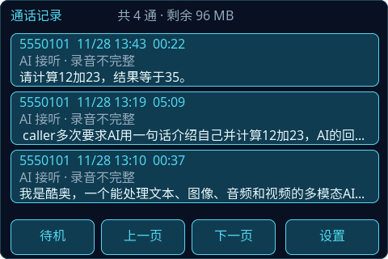
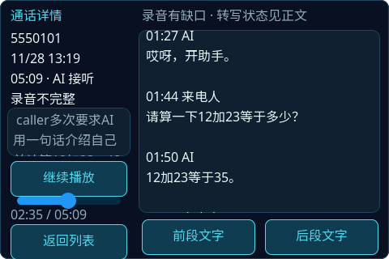
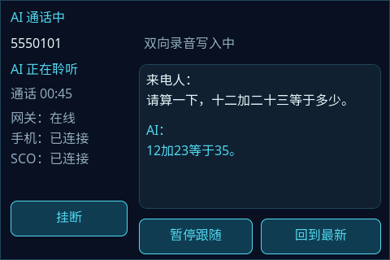
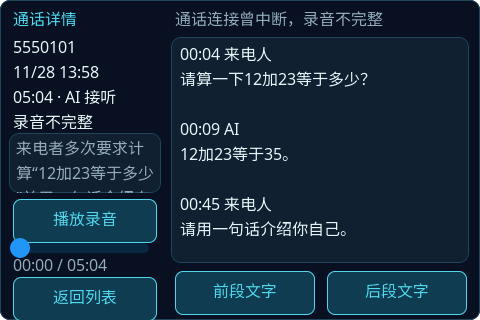

# 阶段五：持续录音、转写与通话记录

日期：2026-11-28。仓库：`D:\work\xiaozhi-realtime`。本文记录新增实现、真实硬件证据和未通过项；阶段四的控制链路故障不能从阶段五的存储结果中消失。

收尾结论：阶段五的双轨 SD 录音、独立完整音轨转写/概要、记录查询与回放已实现并烧录。当前 S3 `0e32c25f…` 与经典 `f9600c3f…` 完成一次 304736 ms、7 输入/7 转写/7 回复的 Android Telecom/HFP 电话，以及与设备后台转写全程重叠的 302.25 秒页面测试；当前单次主机 185 项无跳过通过，双方完整 WAV 与最终文字均已回读。**整体电话语音仍未通过**：本轮双轨累计缺口 6.54 秒，另一次同组合测试出现经典端 lwIP 崩溃，尚未定位根因。详细范围、失败和末轮证据见文末。

后续诊断候选（16:48 后）：S3 `795461fc…` 已应用分区烧录并核对哈希，经典端仍为 `f9600c3f…`。本次仅增加按轨缺口统计，当前五分钟/界面结果仍属于上面的旧 S3 镜像，不能自动继承给候选。新主机回归与 Android 复测的实测结论将在文末单列。

## 实现范围

- S3 使用板级可选存储接口挂载 `/sdcard`，原生 SDMMC 1-bit：D0=GPIO9、CMD=GPIO10、CLK=GPIO11、D3=TCA9554 EXIO3 拉高，10 MHz。挂载失败不格式化卡。
- 经认证的电话状态真正进入 `PHONE_ACTIVE` 后开始记录，挂断后排空已入队音频并提交元数据。单独建立 SCO 不产生一条已接听通话。
- 记录点为网关来音解码后、AI 上传开关前，以及 S3 成功发送 UDP 的去音；AI 没有上传的时段仍保留音轨。它们不是手机远端 DAC 的录音，不能据此证明手机实际播放全部数据。
- 两路分别保存 16 kHz / mono / PCM16 WAV。8 kHz 输入按采样点扩展到 16 kHz，不能恢复原本没有的高频信息。
- PCM 使用独立的有界 PSRAM 单生产者队列；文字另排队，SD 文件操作与网络识别不在电话音频回调中执行。队列溢出、写入失败、丢失媒体均保留为失败或不完整状态。
- 来音按照媒体 generation / sequence 定位，避免 Wi-Fi 突发到包被当成录音空洞；真实缺失序号保留静音位置。去音按实际发送时刻保存。初始媒体建立等待和中途缺口分别计数。
- 每两秒更新 WAV 头、flush/fsync 和元数据；保留旧元数据 `.bak`。重启重建索引，修复未结束 WAV 的长度并标注中断保存，不伪装为完整录音。
- 挂断后分别读取完整双方音轨进行独立 Paraformer ASR，合并最终文字，再异步生成概要；实时对话文字另存，不能冒充完整转写。当前设备端补识别明确支持 `cn-beijing`，其他区域显示不支持。
- 列表每页三条，待机显示最近两条，详情支持文字分页/滚动、播放/暂停/拖动进度；离开停止播放、来电优先。列表长概要采用固定一行截断，不挤掉号码和日期。

人工接管按钮与规则编辑属于阶段六。当前没有将这些尚未落地的交互计入通过项；阶段五音频记录点覆盖后续实际接入的本地媒体，但接管标记及其说话人切换还需要阶段六联调。

## 卡上格式与容量

每次通话目录：`/sdcard/calls/<8位序号>-<8位随机数>/`。

| 文件 | 用途 |
| --- | --- |
| `meta.json` / `.bak` | 记录 ID、电话 call_id、号码、起止时间、时长、接听方式、接管字段、保存状态、首帧时间、实收样本数、丢帧/空洞、转写与概要状态 |
| `caller.wav` | 网关来音 |
| `assistant.wav` | S3 去音 |
| `live-transcript.jsonl` | 实时对话文字，与独立最终转写区分 |
| `caller-asr.jsonl` / `assistant-asr.jsonl` | 完整录音补识别中间结果 |
| `transcript.jsonl` | 按相对时间排序的最终转写 |

`/sdcard/calls/index.bin` 保存固定长度索引，页面增量读取，录音不会整段驻留内存。两路 PCM 合计约 64,000 字节/秒，五分钟约 19.2 MB，另有少量文字/元数据；保留至少 2 MB 空间，不主动删除已有文件。

当前实际卡为 EASTC SDSC，约 121 MB（247808 个 512 字节扇区）；FAT 可用容量 125829120 字节。不要按这张卡的容量估计其他卡。

## 调试命令

新录音元数据包含 `gap_details_available=true`，并分别保存 `caller/assistant_gap_samples`、`caller/assistant_gap_events`、`caller/assistant_max_gap_samples`。采样率统一为 16000，累计样本和最大单次样本需分别除以 16000；双轨累计量不能当作最长一次断音。统计范围仍是两次实际录入之间的缺口，不包括首帧前等待和挂断后的 WAV 对齐补零，也不将自然静音算作缺包。延迟到达但序号连续的来音不会增加缺口。旧记录只有累计值，回读时 `gap_details_available=false`，按轨字段缺省表示未知，不能据此写为零缺失。新字段由生产存储主机回归覆盖双轨独立统计、首尾边界、延迟连续帧和旧元数据兼容。

S3 串口 COM3，115200。两板采集器 `tools/phone_ai_monitor.py` 同时保存 COM3/COM5，HTTP 控制端只绑定 `127.0.0.1:7330`，打开串口不复位板子。

```text
records status
records list
records stop
records remount
records delete <记录ID>
ui home
ui click records
ui click record 0
ui click recent 0
ui click records-next
ui click records-prev
ui click back
ui click text-next
ui click text-prev
ui scroll text 160
ui click play
ui seek 500
ui screenshot
phone status
gateway status
```

`ui seek` 范围 0–1000，500 表示录音中点，走实际滑块释放回调；`ui click` 走实际可见按钮回调，按钮不可见/禁用时不会绕过界面保护。串口测试不等同于实体触摸验收。

`records delete` 是显式调试清理命令，仅在已有 `debug_enabled=true` 时可排队，必须指定完整合法 ID。存储线程拒绝录音、回放、后台转写、手机状态过期或非空闲；不递归删除任意路径。先将指定目录移到 `deleted-<ID>`，使重启索引不会复活半删记录，再删除其中普通文件并重建列表/容量。遇到嵌套目录先拒绝，保留原记录；中断后可用相同 ID 重试已暂存的清理。没有自动淘汰或格式化。用户本次明确允许空间不足时清理；本轮仍先将选定旧测试记录完整导出并校验，保留主机证据。

现有显式调试配置 `debug_enabled=true` 时，可以分块读取已结束记录：`GET /api/test/record-file?id=<id>&file=<允许文件名>&offset=<字节位置>`，每次最多 8192 字节，响应头 `X-File-Size` 为文件总长。接口校验 ID、文件名和录音结束状态，调试关闭时拒绝访问。不把录音和密钥提交到仓库。

手机测试前保持同一路由器、双板已绑定且 `ready=true`，手机连接经典网关的通话蓝牙。S3 插卡、空闲、记录页能读出容量。用另一部手机拨打已连接手机，实际接通后观察“双向录音写入中”；双方分别说一段带数字的句子，挂断后等待补识别和概要，进入同一条记录核对并试听。真实运营商电话与自动化 Android Telecom/HFP 测试分别记录结论。

### 用户真机复测步骤

1. 双板与插卡 S3 保持供电，已绑定并联网；接听手机蓝牙连接经典 ESP32 的通话服务。电脑继续用 USB 采两板日志，无需电脑连接通话蓝牙。不要在测试时同时打开另一个占用 COM3/COM5 的串口工具。
2. 从 S3 待机页进入“通话记录”，确认显示卡容量和已有记录，然后返回待机。已有卡数据保留，不执行格式化、解绑或清空配网。
3. 用另一部手机拨打接听手机，观察约三秒自动接听及“AI 通话中 / 双向录音写入中”。若未自动接听，记录时间并在手机上手动接听；该轮自动接听记失败，仍可继续采集录音问题。
4. 从拨号手机说“请计算十二加二十三”和“请记住明天下午三点开会”，等待 AI 回答；本阶段验收 AI 电话的双方音轨。S3 麦克风人工接管属于阶段六，不能从本轮推定已经实现。
5. 挂断后观察记录保存状态。完整时显示已保存，控制中断、媒体缺口或存储错误应显示不完整/失败；最终录音补识别与概要是后台工作，五分钟双轨可能需要数分钟完成。云端失败保留已有文件，不应伪报转写完成。
6. 从最近记录或列表进入新记录，核对号码、日期、时长、双方文字及概要，试播放/暂停/拖动，返回后应停止；测试过程中出现无声、黑屏、缺字、回放异常时，记下大致时间和刚做的操作，保留供电以便读取现场。

已检查的界面截图：





## 本轮证据与已发现问题

1. 最初候选启动时发生 LVGL 字体悬空指针导致的 `InstrFetchProhibited`。已修正主题字体更换时所有记录/详情控件的字体引用；失败原始日志保留在 `artifacts/phase5-live-20261128-1301`。
2. 第一轮短通话的录音队列与文字共用 try-lock，丢了 8 帧。已拆分为独立无锁 PCM 队列；后续短通话录音入队丢帧为 0。主机回归明确覆盖“文字锁被占用仍采集音频”。
3. 第二轮短通话完成了“请用一句话介绍你自己”的来音、AI 回复、实际 SD 音轨、独立转写和概要。录音 ID `00000002-c7a62920`，37.681 秒，录音入队丢帧 0，但媒体/时间轴累计空洞 26560 样本，因此保存状态正确为 `incomplete`。相关日志 `phase5-phone-short-02`、下载 `phase5-sd-short-02`，不能称为完整录音通过。
4. 截图发现长概要使多行居中标签把号码挤出行顶。已拆成号码/日期、接听/保存状态、单行概要三个固定位置；待机两条最近记录采用同样处理。修正后的截图另行验收。
5. TCP 控制心跳变慢和短暂过期仍会出现；第二轮短通话自动化整体为 FAIL。五分钟采集允许在此类失败后继续留证，但最终仍判 FAIL，未放宽心跳阈值或把重连抹掉。

五分钟候选构建与烧录：`artifacts/phase5-build-06.log`、`phase5-flash-04.log`；应用 SHA256 `ec2493de3ee7ae3fa4a9972740bdf26e591615458b48c5c9005a5b899de8a0d1`。

后续界面修正候选：`phase5-build-08.log`、`phase5-flash-06.log`，应用 SHA256 `f7c90497e4fbb2302c6904976108150e56d6803873a92bea663ef17ff7403b11`。补齐暂停拖动后立即更新时间，以及换记录时清除旧播放进度，均有生产存储代码主机回归。原 NVS、配对信息、资源分区及卡上已有数据保留；经典端本轮未改代码/烧录。

## 五分钟实测详细结果

测试：`artifacts/phase5-phone-5min-01`；两端串口：`artifacts/phase5-live-20261128-1320`。Android 为 Huawei ATU-AL10，使用本地 Telecom 来电应用和真实 HFP/SCO，不拨打运营商号码。

| 观测 | 结果 |
| --- | --- |
| 负载时长 | 请求 300 秒，计入建立/截图/挂断流程后，记录时长 309754 ms |
| 对话 | 9 次固定提问、9 个输入转写完成事件、9 个回复完成事件 |
| 云会话 | 2 次；第 1 次因控制断线终止并重建，整体 FAIL |
| SD 记录 | ID `00000003-e3c2bda1`，call_id=4；重连期间未被拆成另一条正常记录 |
| 录音队列丢帧 | 0 |
| 实际采集样本 | 来音 4886400，去音 4796160；不是补零后的 WAV 样本数 |
| 累计媒体/时间轴空洞 | 215040 个 16k 样本，合计双轨约 13.44 秒；不是单次最长断音 |
| 落盘结果 | `incomplete / audio_gaps`，没有伪报完整 |
| 下载校验 | 双方 WAV 各 9923244 字节、310.1 秒，WAV 头/实际长度一致；文件 SHA256 见 `phase5-sd-5min-01/inspection.json` |
| 独立最终转写 | 来电人 9 段、AI 21 段，合并后时间有序，状态 `complete_with_audio_gaps` |
| 来电人已知语音核对 | 去掉标点，将“十二/二十三”与“12/23”统一后，102 个参考字符编辑距离 0；只适用于这 9 句固定输入 |
| 概要 | 实际生成并保存；会受 ASR 音译错误影响，不能承诺专有名词逐字准确 |

完整 WAV、元数据和文字由 `tools/call_records_inspect.py` 实际下载，证据目录 `artifacts/phase5-sd-5min-01`。来电人核对见同目录 `transcript-comparison.json`。

另对 Android 实际接收到的 AI 声音作 ASR 抽查：保留原始 311.74 秒 WAV，按能量选取带前后余量的 70.83 秒语音诊断片段，结果在 `artifacts/phase5-phone-5min-asr`。存在音译/重复/数字错误（如一处 35 被识别为“30度”），因此不能把“9 个回复完成”称为连续清晰语音通过；裁去静音的 ASR 片段也不用于计算真实断音时长。

负载末尾串口截图有一次 offset 缺口，校验器拒绝了该图，失败保留在测试日志。空闲截图后续重取成功。采集工具已修正状态请求与截图并行时只看短日志尾部的采样问题，等待本次请求的新鲜响应；相关主机回归 8 项通过。该修正不改变上述真实控制重连的 FAIL。

## 验收状态（按验证范围）

| 项目 | 当前证据/结论 |
| --- | --- |
| S3 真卡挂载、建目录、双路 WAV、元数据持久化 | 实机已执行 |
| 挂断后独立 ASR 和概要 | 第二轮短通话已执行；专有名词识别有差异，不能承诺逐字准确 |
| 录音热路径不受文字锁阻塞 | 生产存储代码主机回归通过；修复后短通话 drops=0 |
| 5 分钟 Android + AI + SD + UI | 已执行并完成保存/补识别；整体稳定性 FAIL，见上表 |
| 列表/详情/最近两条/分页/播放/暂停/拖动/来电抢占 | f7c90497 候选串口实际控件回调与截图已执行；界面功能通过，通话录音另有下述失败 |
| 无卡、满卡、写入失败、缺失音轨、中断恢复 | 主机真实文件/故障路径已覆盖主要场景；物理拔卡、实际填满用户卡未执行 |
| 运营商电话、用户实际听感、实体触摸 | 未执行，不能从自动化数字路径推广 |

后续实测结果补在本文件，未运行和失败项不改成通过。

## 回放切换来电的录音缓存回归

`f7c90497` 候选的界面检查见 `artifacts/phase5-ui-ready/result.json` 与已校验 PNG，两板日志在 `artifacts/phase5-live-ready`。暂停后拖动到中点显示 02:35/05:09，恢复播放、离开停止、来电抢占、文字分页滚动与记录翻页均走实际控件回调。串口验证不替代实体触摸或声学试听。

同一次来电生成记录 `00000004-28a37379`，时长 22325 ms，**录音队列 drops=191，累计 gap_samples=66880**，正确标记 `incomplete/audio_gaps`；之后独立转写和概要完成。这是新的 FAIL，不能用上一轮五分钟 drops=0 覆盖。旧日志没有写卡耗时，尚不能把根因归为 SD 卡；回归同时包含通话中串口截图。

修正候选将音频/文字队列容量拆开：PCM 为 1024 帧（两轨各 20 ms 时约 10.24 秒），文字为 64 条，两者均显式 PSRAM 有界分配。新增持久诊断字段 `queue_peak`、`max_write_ms`、`max_sync_ms`、`max_drain_gap_ms`，并将 `dropped_frames` 与 `text_drops` 分开。`storage` 日志每次同步报告队列与最长耗时，音频入队路径没有文件操作或日志输出。缓存增加只能吸收有限停顿，不能证明底层延迟或无线音质已经解决。

生产存储代码主机回归覆盖消费者停顿时 600 帧完整保留、1024 帧容量边界、超过边界精确计数、文字溢出独立计数及诊断字段落盘回读；`artifacts/phase5-host-records-queue.log` 两项通过。候选编译 `phase5-build-09.log` 通过，实机回归结果待补。

`fd4b2140` 实机候选（`phase5-build-09.log` / `phase5-flash-07.log`）在回放抢占重试时记录到写音频调用最长 2015 ms、取队列最大间隔 5228 ms、峰值 377/1024 帧，录音入队 drops=0。这支持旧 256 帧容量不足以覆盖已观测停顿，但不能反推旧 191 帧失败的唯一根因。日志在 `phase5-live-queue`，UI 与电话事件在 `phase5-ui-preempt-queue`。

同次重试还暴露旧六秒控制状态超时会拆分 call_id=6（`00000005-db6e166e` 与 `00000006-2a5da36e`）；第一条 15593 ms，第二条带前置静音，不能称作连续记录。修正为存储会话保留最多 30 秒以等待同一 call_id 恢复：新鲜挂断/新来电仍立即提交，永久失联有界结束，经历控制中断的记录保守标为 `incomplete/call_state_lost`。电话和媒体的有效期、AI 停止条件均未放宽。生产代码回归覆盖七秒控制失联后保持同一 ID，以及超过保留时间后结束存储。

当前候选编译 `phase5-build-10.log`、烧录 `phase5-flash-08.log`，应用 SHA256 `90fbece9a16dcffde5f45fea85d44a07e9f3bf05dd835bc2c9ce6a9bcb175b47`；仅更新应用分区，经典端固件未修改。定向主机回归两项通过（`phase5-host-records-reconnect.log`），关闭功能的源码编译与格式检查通过。

`phase5-storage-5min-02` 首次尝试未进入通话：经典端记录 `AUTO_ANSWER suppressed reason=assistant_link_unavailable`，未产生新录音，测试为 FAIL。不能把自动接听受抑制说成 SD 录音失败或掩盖为通过。后续重试另记目录，保留首次结果。

## 当前候选五分钟回归（2026-11-28）

证据 `artifacts/phase5-storage-5min-03`，双板连续日志 `artifacts/phase5-live-final-02`；Android 本地 Telecom 来电经真实 HFP/SCO，包含先播放旧录音再来电抢占、七次固定提问和通话中两次截图。重试自动接听成功，没有走串口手动接听补救。已结束自建通话并停止手机测试音频，保留原自动接听策略。

| 项目 | 结果 |
| --- | --- |
| 通话记录 | `00000007-6237bb65`，call_id=8，304707 ms |
| 控制恢复后的记录数量 | 从 6 到 7，仅增加一条，没有拆分 |
| 音频 / 文字入队丢失 | 0 / 0 |
| 音频队列峰值 | 90/1024 帧 |
| 最长音频写调用 / 同步 / 取队列间隔 | 490 / 811 / 1190 ms |
| 实际采集样本 | 来音 4749440，去音 4648000 |
| 双轨累计媒体/时间轴空洞 | 339520 样本，21.22 秒合计；不是最长单段停顿 |
| 保存 | `incomplete/call_state_lost`，`audio_available=true` |
| 总体稳定性 | **FAIL**；控制新鲜度短暂失效、云会话重建均保留在日志 |
| 录音缓存与同次通话身份专项 | 本轮 **PASS**，不等同于连续清晰语音通过 |
| 通话中截图 | 40 秒、200 秒两张校验通过并查看，显示双向录音与双方文字 |

双方 WAV 均已实际下载回读，各 9754924 字节 / 304.84 秒，16 kHz 单声道 PCM16，头与文件长度一致，SHA256 在 `phase5-sd-5min-03/audio-inspection.json`。最终元数据、文字和哈希在同目录 `meta-final.json`、`transcript.jsonl`、`postprocess-inspection.json`。最终转写来电人 7 段、AI 10 段，时间排序校验通过，状态为 `complete_with_audio_gaps`；概要完成，保留 ASR 自我介绍音译不准的内容，不能当作准确原话。

七句固定来音按标点与数字写法规范化后，82 个参考字符编辑距离为 1（1.22%，一处“多少”少了“少”），见 `caller-comparison.json`。这只验证本轮已知输入，不代表手机实际接收到的 AI 声音或 S3 扬声器已通过声学验收。后台双轨 ASR/概要耗时约 381 秒，本轮没有因识别慢而把未完成标成完成。

最新存储候选还执行最近记录进入详情、三页记录翻页和返回待机，`phase5-ui-final-idle` 的实际控件回调与截图通过并查看。截图发现内部错误码直出详情页，已增加中文提示（控制中断、缺口、卡不可用/空间不足、文字/录音读取失败），原错误码继续保留在元数据和串口日志。该纯界面修正另编译/烧录并核对，五分钟媒体结果仍明确对应 `90fbece9` 候选。

## 用户手机测试环境

最终纯界面修正候选：`phase5-build-11.log` / `phase5-flash-09.log`，应用 SHA256 `e6799e2b9030a370fb1fb34e666268ae9dea3b710e0034054741ad94aefe87be`。烧录校验通过；重启后真卡挂载、七条记录及已完成转写/概要均保留，详情中文提示截图校验并查看。音频/存储逻辑与五分钟 `90fbece9` 候选一致，未把该五分钟结果冒认为界面修正后重新跑了一轮。



2026-11-28 14:12（UTC+8）恢复双板采集，目录 `artifacts/phase5-user-test-20261128-141205/`，包含 `serial-COM3.jsonl`、`serial-COM5.jsonl` 和 `preflight.json`。监视进程 PID 16412、控制 API `127.0.0.1:7330`，当前指针保存于 `artifacts/phase5-current-monitor.json`。在本次交付时进程继续运行，后续操作先核对实时状态，不能把本文快照当作永久在线证明。

交付预检：S3 待机、网关 `ready/fresh=true`、手机 HFP 已连接且无正在进行的通话、自动接听启用、SD 可用约 75 MB、七条记录可读，未观察到启动崩溃或内存分配失败。不要同时打开另一个占用 COM3/COM5 的工具。

阶段五的软件功能、Android HFP/SD/云端补识别与串口界面测试已执行；**整体无线控制/连续清晰语音仍未通过**，真实运营商电话、实体触摸、声学回放、实际拔卡/填满卡仍由各自范围验收。用户现在可以按本文步骤进行真机复测并留存两端日志，不能据此把已有 FAIL 改成发布通过。

### 14:23 后用户复测准备与只读诊断

本次没有重新烧录、复位或自行发起电话。新鲜预检保存在同一采集目录的 `user-test-preflight-20261128-142335.json`：两板 `ready/remote_fresh=true`，手机 HFP 连接，上一通 call_id=8 已结束，自动接听启用，SD 挂载且剩余 78620672 字节。双板串口进程 PID 16412 继续采集；另启动 PID 16712 的 Android 筛选日志，文件 `android-logcat-20261128-142402.log`，记录测试应用、蓝牙 HFP、音频路由和崩溃信息。后续仍须核对进程和新鲜输出，不能把 PID 当作持续在线保证。

14:26–14:31 增加五分钟有界只读观测，每五秒查询电话状态并分别向两板发一次 ICMP。`passive-observations-20261128-142601.jsonl` 共 60 组，所有观测均为上一通电话已结束，没有新来电，也没有活动通话；两板各 60 次 ICMP 均收到回复，S3 往返 3–118 ms、经典端 5–217 ms。统计见 `passive-observation-summary.json`。这不是通话负载测试、UDP 丢包率或音质验收；该辅助进程已按时结束，双板串口和 Android 日志继续采集。

待机串口仍出现控制收包等待，保存的 `idle-control-analysis-20261128-142950.json` 中 S3 最长 3306 ms、经典端最长 3120 ms，统计窗口没有控制关闭事件。15 对等待事件中，经典端收完请求后 0–100 ms 内 S3 即收完响应，说明还应检查 S3 到网关的请求路径，不能只归咎于第二个状态帧或 SD 写卡。应用日志不能证明 TCP 重传，也不能区分无线、协议栈调度等原因。

经典端源码已有一项待实测候选：每个 PONG 与电话状态仍分别计算 HMAC、保持原来的两个 128 字节帧，但合并为一次发送。真实发送函数主机检查一项通过，既有电话控制／跨库头兼容检查两项通过；正确构建目录 `build-provision-psram` 构建成功（`D:/work/Bluetooth-gateway/artifacts/phase5-control-batch-build-02.log`），有效 sdkconfig SHA256 与上一份实机配置同为 `397f1facb994696fae788095c54733546f2969e7196a39fa25b7701af2b896be`。**候选尚未烧录，效果未验证**；当前用户复测继续使用原经典端固件，不能把源码修改称作问题已修复。此前误用旧构建目录的链接失败也保留在 `phase5-control-batch-build.log`，该失败产物没有烧录。

当前源码再次运行主机全量发现：`phase5-host-full-07.log` 为 180 项、含三处环境跳过（MCP 类初始化及两个资源工具测试）。修正测试环境的头文件路径、对象文件语言参数和 Python 依赖后，六项定向回归无跳过通过，见 `phase5-host-missing-08.log`。与当前发现的测试 ID 逐项核对，共 184 个不同测试均有通过证据，无遗漏，清单 `phase5-host-coverage-07.json`；这是两次运行的合并覆盖，**不是一次全量无跳过运行**。首次跳过及中间环境失败日志保留，不替代电话实机验收。

### 用户授权继续后的响应合并候选回归

用户明确表示“我暂时不测，你继续修改和自动测试”后，经典端应用 `02d50a4667504b3ade33a99f3e5a48769f5e17981a37f09fb84c9e304e6da736` 已只写应用分区并核对烧录哈希，保留 NVS。启动实际检测 8 MB PSRAM、4 MB 映射、内存测试与源码 mSBC 编码器自检通过，自动恢复 Wi-Fi、双板认证和媒体工作模式；手机 HFP 经测试应用连接后进入新一轮。S3 保持 `e6799e2b` 固件。这与上段“待烧录”的时间点不同。

证据：`artifacts/phase5-live-batch-01/` 双板日志，`artifacts/phase5-storage-5min-batch-01/` 电话/UI/Android 录音，`artifacts/phase5-sd-5min-batch-01/` 实际文件回读。自动接听、回放来电抢占、7 次固定输入及 40/200 秒两张通话截图均完成，截图校验后已实际查看。

| 项目 | 本轮结果 |
| --- | --- |
| 记录 | `00000008-43ad71a3`，call_id=1，304943 ms；记录数 7→8 |
| 音频 / 文字入队丢失 | 0 / 0 |
| 缓存峰值 | 332/1024 帧 |
| 最长写音频 / 同步 / 取队列间隔 | 521 / 800 / 8982 ms |
| 实际采集样本 | 来音 4863040，去音 4760320 |
| 双轨累计空洞 | 117120 样本，合计 7.32 秒；不是最长单次停顿 |
| 控制连接关闭 | 本轮活动通话中未观察到 |
| 控制状态过期 | 存在；S3 一次收包等待 2223 ms，存储记录 `control_interrupted` |
| 保存 / 稳定性 | `incomplete/call_state_lost`；整体 **FAIL** |
| 录音缓存与通话身份专项 | 本轮 PASS，不能推广为连续清晰语音通过 |

双方 WAV 均为 9762604 字节、4881280 样本、305.08 秒，16 kHz 单声道 PCM16，头与实际长度一致。来音 SHA256 `f3d5fd76f16d2f32930f78ffa69b43b854ef432991011f4c0ea4ffeb52229465`，去音 SHA256 `d3314ad5c74fb317eef8bd48789efac7ea5e4748775e97e75a952d56db6bd913`。元数据/实时文字及文件指标保存在 `audio-inspection.json`。结束时独立 ASR/概要仍 pending；另启动手机实际收到的整段 WAV 的 ASR，不能提前写成完成。

响应合并没有消除超过两秒的等待，不能据此宣布根因已解决，也不能仅比较两次累计空洞就宣称确定改善。下一轮增加双方 `control_tcp` 只读诊断，按 TCP 重试次数、未确认数据、发送积压、协议栈回调延迟和控制任务栈余量区分后续方向；认证、新鲜度及媒体授权门槛均未放宽。诊断的两份实际头文件相同，延迟回调、单槽待处理、无效连接和排队失败路径的主机检查 2 项通过；两端实际编译成功。此处先记为待部署/待实测，后续补充实际固件身份和结果。

### 控制诊断、转写后崩溃与截图传输故障

经典端诊断应用 `20de45f88124db20b6d0fdc3e778161eb6ebbcc5d17e810da71d933077ac7979` 已烧录，日志 `phase5-live-control-diag-02`。原 S3 `e6799e2b` 在挂断后独立转写期间发生 `LoadProhibited`，`EXCVADDR=0x8`。使用与实机相同的备份 ELF 解码，故障在 `spi_bus_lock.c:bg_exit_core` / `spi_master.c:spi_intr`；被中断的是音频输入重采样，不能把被中断任务当作崩溃根因。保留完整寄存器/回溯及重启日志，不能用“通话中无崩溃”覆盖该失败。

本机 SDK 仍有 SPI 总线锁的跨核心交接路径；官方 [ESP-IDF #18527](https://github.com/espressif/esp-idf/issues/18527) 记录了相同位置/空指针特征及同核缓解建议。本板只将 LVGL 任务与 SPI2 ISR 明确固定到 CPU0，保持驱动调用栈使用内部 SRAM；SD 继续走 SDMMC。该修改是板级缓解候选，不是已证明唯一根因，也未修改全局 SDK/管理组件。S3 `1b0516e9323743776d2d7be24d24e7c939aafa5208b5a9d7b4faf5f71d517ef3` 应用已烧录并校验，双板诊断见 `phase5-live-control-diag-lcd-03`。同核候选恢复后完成上述录音的独立双轨识别及概要，期间未观察到同类崩溃；不能替代后续完整回归。

最终文件 `phase5-sd-5min-batch-01/meta-final.json`、`transcript.jsonl` 已实际回读，来电人 7 段、AI 11 段，合并时间顺序正确，转写 `complete_with_audio_gaps`、概要 `complete`。7 句已知来音按明确的标点/数字规范化为 82 个参考字符，编辑距离 0；手机完整 307.16 秒 HFP 接收 WAV 的独立 ASR 与同轮实时 AI 文本比较为 30/136（22.06%）字符差异。详见同轮 `caller-comparison.json`、`phone-asr-comparison.json` 及 `phase5-phone-batch-full-asr-01/result.json`。后者含名称/普通词语差异，不能称为 UDP 无线丢字率或连续清晰语音通过。

诊断还捕获经典端响应 `inflight=256/unacked=1`，随后 `retries=1/rto_ms=5000`，而 S3 已等待数秒没有收到响应，双方 TCP/IP 回调延迟为 0 ms。另有 S3 请求 `inflight=128` 的等待。这证明至少部分停顿包含 TCP 重传/退避，不能推广为所有停顿都是同一根因。控制任务栈低水位经典约 1144 字节、S3 约 728 字节；继续保留诊断观察。

界面/后台转写并行脚本 `phase5-ui-postprocess-diag-03` 未完成五分钟：15 秒截图通过，150 秒截图在 offset=19776 的 Base64 行少一个字符，被校验器拒绝，保留 `snapshot-failures.json`；脚本还使用了一次无效 `ui back`，已另发正确 `ui click back` 并记录修正，不能称作原脚本全通过。串口输出使用的 SDK VFS 逐字节发送函数会在 TX 超时后丢弃字符，而上层仍返回写入长度；因此截图改用短行、有界等待、直接驱动整行入队，仍保留长度/偏移/整体 FNV 校验，不对损坏证据补字节。短行与单字符丢失主机回归 6 项通过，实机复测待补。

最新主机全量 `phase5-host-full-diag-09.log` 为 **184 项、无跳过通过**；此后增加短行损坏回归 1 项，定向运行 6 项通过。不能把此前两次合并覆盖冒认为当时一次无跳过全量运行，也不能把新增后的 185 项称为已单次全量运行。

下一项 TCP 参数 A/B 候选只调整 `LWIP_TCP_TMR_INTERVAL:250→100 ms`、`LWIP_TCP_RTO_TIME:1500→600 ms`。由 SDK 生成隔离 sdkconfig，两端与备份逐键比较都只有这两项变化，见各仓库 `artifacts/phase5-tcp-profile/config-diff.json`。维护源为经典 `config/coex.defaults` 与本板 `config.json`；手机状态两秒有效期、控制六秒超时、认证和媒体授权门槛不变。经典应用 `f66819c669fa88ec15e49edd6168bda40ba48ded8a373d438e30c57a6f58702b` 已只写应用分区并核对哈希；S3 候选仍在编译，未把未运行候选写为改善或通过。

### 双板 TCP 参数实测、USB 输出交织与经典解码崩溃

双板参数候选已实际部署：S3 应用 `8b1d2a60e085bc7b9f7b93bc33ff9c69ffdcce8070ab8ef1d6b87884d9cc044e`、经典端仍为上述 `f66819c6…`。`phase5-storage-5min-tcp-01` 完成 306399 ms 电话、7 个已知输入、单条 `00000009-053a365d` 记录，缓存峰值 331/1024、音频/文字入队丢失 0/0。活动期间未见控制关闭、状态过期或崩溃，S3 采样的心跳年龄最大 590 ms；经典一次接收等待 1396 ms，不能等同于 S3 电话状态已过期。双方累计录音空洞 82240 样本（5.14 秒，不能作为最长连续停顿），正确标记 `incomplete/audio_gaps`，不能宣布整体无线音质通过。

两次通话截图均校验失败。原短行实现仍把截图交给 USB 驱动 TX 队列，而普通日志的 VFS 仍采用默认直接 FIFO 轮询输出；主机实际看到 Base64 内夹入日志字符。日志与截图不能混用这两个发送路径。现在在 `StartGatewaySerial()` 成功安装驱动后调用 `usb_serial_jtag_vfs_use_driver()`，共享中断驱动 TX 队列，保留短行、有界发送和整体校验。S3 应用 `70d9dd20c85a94f37db49f68247e0eb6fe8d37a27dedc882cb8bc57f074ff2c1` 已应用分区烧录并 Hash verified；待机、40 秒及 200 秒截图均已校验，待机和故障页已实际查看。见 `phase5-usb-shared-preflight-01`、`phase5-storage-5min-usb-01`，不能掩盖前轮截图失败。

该复测在约 37 秒捕获经典端 `StoreProhibited`，故不是有效的五分钟音频通过。使用冻结 ELF SHA256 `ad8c30a8fe4d6c19a7cb2cb5ba6c25f78f60c8cc5f2af59ad1125a5f47cca52d` 解析完整核心转储，调用链为 `SynthWindow80_generated → OI_SBC_SynthFrame_80 → OI_CODEC_SBC_DecodeFrame → esp_sbc_dec_decode → decode_msbc → codec_task`，故障地址 `0x80154818`。这次控制重传和 S3 媒体超时发生在经典端崩溃之后，不能归咎于 TCP 参数或把它当作已定位的无线故障。原始日志、核心转储与匹配分析见 `artifacts/phase5-classic-decoder-crash-01/`，串口完整记录见 `phase5-live-usb-shared-01`。

异常记录 `0000000a-ebab3fd0` 实际保存 49294 ms，音频/文字丢失 0/0，正确标记 `call_state_lost`，挂断后仍完成独立转写和概要；界面显示“网关音频超时”。这是异常保存和故障提示证据，整体仍 FAIL。经典仓库新增组合配置 `config/sbc-source-codec.defaults`，同时启用既有源码 encoder 与源码合成滤波器，避免只替换编码器而遗漏解码路径。生成配置与崩溃版本逐键比较只有 `GATEWAY_SBC_SOURCE_FILTER:n→y`；此时仍在构建，效果待部署复测。已有 32 组滤波输出与 64 帧编码逐字节启动自检继续保留，不能用启动自检替代电话负载验收。

本轮主机补测：截图解码/损坏拒绝 6 项通过；经典批量响应、TCP 诊断及电话控制 5 项通过。格式检查及差异检查通过。此前单次全量 184 项、其后新增一项的覆盖范围保持原记录，不回填为当前配置的一次全量 185 项运行。

### 源码编解码组合、完整文件回读与页面最终回归

经典应用 `f9600c3f1b94d9003a9502a3c804e2d41adac595ee7874d3ba0ee80573451247` 已烧录并核对哈希；真实启动完成滤波器 32 组和编码器 64 帧输出一致性自检，检测 8 MB PSRAM、4 MB 映射，恢复认证和手机 HFP。与 S3 `70d9dd20…` 完成 `artifacts/phase5-storage-5min-source-codec-01/`：304739 ms、7 次已知输入/7 次转写/7 次回复、单一云会话，活动及收尾窗口没有双板 panic、控制关闭、过期采样或云失败。数字会话专项 PASS，不能继承为声学或运营商验收。观察日志冻结于同目录 `evidence-COM3.jsonl` / `evidence-COM5.jsonl`，各自 SHA256 为 `7e817ee2dbf1ff2e0758bbeaf5a8700a36946156728d0ad487a09ff9c1c14be2` / `865b380bfa39f75571bf02986f755607970123d08f71cae2d9c068ee3b73a50c`；主机时间窗口和判定见 `joint-analysis-v2.json`。

| 项目 | 本轮实际结果 |
| --- | --- |
| 记录身份 | `0000000b-b3b71c4d`，总数 10→11，只有一条本次记录 |
| PCM / 文字入队丢失 | 0 / 0 |
| 录音缓存峰值 | 65/1024 帧 |
| 最长音频写入 / 同步 / 取队列间隔 | 350 / 477 / 1084 ms |
| S3 控制年龄采样最大值 | 546 ms；活动窗口未见控制关闭或过期 |
| 双轨累计空洞 | 76480 样本，合计 4.78 秒；不是最长连续停顿 |
| 经典活动窗口 raw/bad 增量 | 39597 / 4212，约 10.64%；不能等同于全部不可恢复语音 |
| 经典 UDP 接收 / 接受 / 迟到增量 | 14607 / 14514 / 93，迟到约 0.637%；越窗为 0 |
| 抖动过载 | 22 次，丢弃 22 包、跳过 3800 样本（累计 237.5 ms） |
| 存储结果 / 无线整体 | 存储队列与身份专项 PASS；`incomplete/audio_gaps`，整体仍 FAIL |

S3 RX 统计还记录过最大接收间隔 419 ms。该计数器跨媒体会话累计，不能把最后一行的所有 gaps/rebuffer 直接归到本次通话；逐通话的录音空洞以元数据为准。上述缺包、迟到和跳样仍阻止“连续清晰语音已通过”的结论，不能因为没有崩溃或 ASR 识别出内容而忽略。

实际双方 WAV 均为 9754284 字节、4877120 样本、304.82 秒，16 kHz / mono / PCM16，头与数据长度一致。来音 SHA256 `27188c616ea2a95ba1747f026fd0a60f9719d43043ef6a75e356e57063ca96a7`，去音 `5f88ca5c167215e0d94c924495490606eea821719632b0141b2ea2f3186cc921`。完整文件、校验和与指标在 `artifacts/phase5-sd-source-codec-01/`。已回读最终 `meta-final.json` 及 `transcript.jsonl`：来电人 7 段、AI 9 段，时间顺序正确，独立转写为 `complete_with_audio_gaps`，概要为 `complete`；两条轨道确实进行了补识别，未用实时文字冒充完整转写。

手机实际收到的完整 306.98 秒 WAV 也完成独立 ASR，音频 SHA256 `c63fd65a473050aee2a864b8e231ce6f86c41c145d75bc7894c6466a381976d3`。`asr-comparisons.json` 明确记录数字/标点规范化和各比较范围：7 句已知来音为 0/86 字差异；手机接收 ASR 对实时 AI 文本为 22/137（16.06%）；SD 去音 ASR 对同一文本为 27/137（19.71%）；手机 ASR 对 SD 去音 ASR 为 15/125（12%）。两份录音的 ASR 都存在名称及普通词语差异，后者也不是人工真值；不能把这些数字称为纯无线丢字率，也不能用跨轮不同回复的比例直接推导补丁改善幅度。

随后页面脚本 `phase5-ui-postprocess-source-codec-01` 实测确认播放、暂停、中点拖动、继续播放及后段文字；在前段文字检查失败后中止。代码的后段一次前进多个句子，前段却只退一个句子，实测 8→7，没有回到上一页。已改为存储工作线程在原有 JSONL 扫描中计算实际上一页边界，通过 `transcript_previous` 提供给 UI；不新增整段转写缓存，长句提前占满页时也保持前后对称。生产存储回归覆盖普通 8 句页及长句 7 句页的三页往返，通过后才构建部署。

分页修复的 S3 应用 `ff15854230de809994dcdca7d53e2f03b1b3954759bab1424a392eb6858ffde9` 已只写应用分区、Hash verified，保留 NVS 和 SD。最终单次全量主机 **185 项、无跳过通过**，229.778 秒，证据 `artifacts/phase5-host-full-final-12.log`，其中出现的超分区报错来自预期负例测试，测试总结果为 OK。新增后的当前版本至此才有一次全量无跳过证据。

实机页面脚本 `phase5-ui-postprocess-source-codec-02` 完成 304.109 秒：播放、暂停、拖动中点、继续播放、文字前/后段、退出停止播放、列表前/后页九项均有新鲜状态确认，15/50/270 秒三张截图全部通过偏移/长度/FNV 校验，并实际查看详情、暂停中点和列表。另用真实 LVGL 滚动命令与前后截图确认内容从 00:03 段滚到 00:45 段，证据 `phase5-ui-scroll-final-01`。保留前一轮失败，不把它回填为五分钟 UI 通过。该次完整页面回归时转写已完成，不能声称完整五分钟都在与 ASR 并发；前轮约 70 秒操作及通话中截图分别保留其实际并发范围。

可视结果归档：

- [通话与实时文字](phase5-ui-20261128/source-codec-call-active.png)
- [记录详情](phase5-ui-20261128/records-detail-final.png)
- [暂停并拖到中点](phase5-ui-20261128/records-paused-midpoint-final.png)
- [记录列表](phase5-ui-20261128/records-list-final.png)
- [正文滚动](phase5-ui-20261128/records-scrolled-final.png)

分页修复镜像 `ff158542…` 的短通话 `phase5-final-ui-smoke-call-01` 已完成：1 输入/1 转写/1 回复、单云会话，自动接听和挂断回到 ready 的数字路径 PASS。新增记录 `0000000c-a22d3b71`，实际通话 51418 ms、音频/文字入队丢失 0/0、队列峰值 362/1024，双轨累计空洞 16000 样本（1 秒），正确标记 `incomplete/audio_gaps`。最终元数据和三行独立转写已实际回读至该测试目录 `sd/`，概要完成；卡剩余 13451264 字节。

这次通话截图仍失败，保留 `screenshot_failed`，不能因 `DIGITAL_PATH_PASS` 掩盖。原始串口显示 `I (428993) wifi:UI_PIXELS 286656 ...`，下一行才出现 Wi-Fi 日志正文；数据块本身未丢失，但日志先写前缀、后写正文，使严格锚定行首的采集器跳过该块。共享 USB TX 队列解决字节交织，却不能保证一次日志调用只有一个底层写入。新增修复在同一次有界 driver 写入内给每个截图帧添加前导换行，确保帧从行首开始；不修补 Base64、不修改主机偏移/长度/FNV 门槛。应用 `c512d057b0fa21cbd8e72c9283a494caa0cdd489fbe88e1738b279b3e445b295` 已构建和应用分区烧录，Hash verified，冻结产物 `phase5-snapshot-boundary-firmware-01/`，截图损坏拒绝回归 6 项通过。

该修复实测 `phase5-snapshot-boundary-smoke-01`：53856 ms、1 输入/1 转写/1 回复、挂断恢复，数字路径 PASS。通话截图 307200 字节、FNV `e2e0b4d6`，偏移、长度及校验全部通过，已实际查看；传输窗口同时出现 Wi-Fi 的 `Set ps type`、SD 写入、云端上传和网关心跳日志，覆盖上轮出现问题的并发情形。新记录 `0000000d-469bff1a`，音频/文字入队丢失 0/0、峰值 94/1024；双轨累计空洞 42560 样本（2.66 秒），仍为 `incomplete/audio_gaps`。独立 ASR、概要已完成，最终元数据和两行转写实际回读，见该目录 `final-audit.json` 与 `sd/`。共有 13 条，卡剩余 10059776 字节；未把这通短测升级为五分钟验收。

上述五分钟音频结果属于明确标识的 S3 `70d9dd20…` 图像；不会把该数字会话 PASS 自动继承到后续图像。全量 185 项在该时点属于分页修复状态，最后截图边界补丁另做构建、6 项定向测试及实机复测。物理触摸、运营商/微信、可靠声学、实际拔卡/满卡/断电仍未验收。

### 授权清理容量、当前固件回归与新的经典端故障

用户补充允许 SD 空间不足时清理。已先通过只读接口将早期测试记录 `0000000b-b3b71c4d` 的双方完整 WAV、最终元数据/转写及实时文字导出至 `artifacts/phase5-precleanup-backup-01/`，头/长度/完整 SHA256 均验证，与上文已归档 WAV 哈希一致。只删除这条明确备份的测试记录，其他记录及根目录文件保留；没有格式化。

清理命令由独立存储线程执行，具有调试开关、准确 ID、手机新鲜空闲、非录音/回放/后台转写等约束，先暂存目录再重建索引，支持中断后重试。生产存储测试补齐关闭调试、路径逃逸、状态过期、活动电话、后台转写、回放、嵌套目录拒绝、其他文件保留及删除中断恢复。单次全量 **185 项、无跳过通过，240.655 秒**，`artifacts/phase5-host-cleanup-final-01.log`。S3 当前应用 `0e32c25f02e22202fa48a1e4ddcb48eda806e41cfbb69990f1efc73a01d8170a`，冻结 `phase5-record-cleanup-firmware-01/`，应用烧录 Hash verified；经典仍 `f9600c3f…`。实际清理 `phase5-record-cleanup-test-01` 通过，记录 13→12，空闲 9955328→29480960 字节，最近记录 `0000000d-469bff1a` 保留。

当前固件长测前两次在 Android USB 前置检查失败，尚未创建电话，不计作音频失败或通过。12 次 USB shell 探测仅 5 次成功，多次返回 device not found；临时通过 `adb tcpip 5555` 改用手机 `192.168.5.18:5555`，并验证 `ro.serialno=TPE9X18C17W07990`。仅调试控制改为局域网，实际音频继续走手机 HFP/SCO↔经典 ESP32↔UDP↔S3。

`phase5-storage-5min-cleanup-final-03` 在约 40 秒捕获经典端 `LoadProhibited`，随后 S3 显示 `gateway_media_timeout`。匹配 ELF `d1690c9f…` 的完整 core/回溯为 `pbuf_remove_header → udp_input → ip4_input → ethernet_input → tcpip_thread_handle_msg → tcpip_thread`，PC `0x4016aae7`、EXCVADDR `0x80174d93`。原始 core 与匹配分析在 `artifacts/phase5-classic-lwip-crash-01/`，不能称与旧 SBC 崩溃同一已证根因，也不能归咎于 SD 卡或仅凭一次调用链确定 SDK 缺陷。该失败明确证明源码编解码组合的一轮五分钟无崩溃不足以保证经典端长稳。

失败现场记录 `0000000e-7e5a3858` 保存 54394 ms，PCM/文字丢失 0/0、队列峰值 92/1024，正确标记 `incomplete/call_state_lost`，独立转写/概要完成；两张故障期截图通过校验。五分钟观察窗口里有效电话在经典端崩溃后已经中断，因此该轮整体 FAIL，不能把 300 秒采集窗口称为 300 秒正常电话。失败和双板日志冻结在同轮目录，具体判定见 `joint-analysis-v2.json`。同一固件重新连接 HFP 后的重试另行登记，不能覆盖此失败。

### 当前镜像五分钟电话、完整文件、ASR 与并发 UI 最终结果

在上述同一 S3/经典固件组合上重连 HFP，`artifacts/phase5-storage-5min-cleanup-final-04/` 完成 304736 ms 电话，自动接听、旧录音回放被来电抢占、7 输入/7 转写/7 回复、单一云会话、挂断恢复均有实际状态证据。数字会话专项 PASS，不能升级为整体稳定性通过；上轮 lwIP 崩溃继续是未解决项。双板本轮证据和 SHA256 冻结在该目录 `evidence-COM3.jsonl` / `evidence-COM5.jsonl`，采样范围与判定见 `joint-analysis-v2.json`。

| 项目 | 当前镜像本轮实际结果 |
| --- | --- |
| 新记录 / 唯一性 | `0000000f-40c23ac8`，本轮记录数 13→14，仅新增一条 |
| PCM / 文字入队丢失 | 0 / 0，队列峰值 50/1024 |
| 最长写入 / 同步 / 取队列间隔 | 251 / 354 / 1336 ms |
| 认证控制 | S3 最大采样年龄 552 ms，无过期采样、关闭或双板 panic |
| 双轨累计空洞 | 104640 样本，合计 6.54 秒；不是最长连续停顿 |
| 经典 raw / bad 增量 | 40154 / 4226，约 10.52%；不能等同全部语音不可恢复 |
| 经典 UDP 接收 / 接受 / 迟到 | 14780 / 14672 / 108，迟到约 0.731% |
| 越窗 / 重复 / 抖动过载跳样 | 0 / 0 / 0；不能从单轮变化推导修复因果 |
| 编解码 / UDP 发送错误 | 0 / 0 |
| 保存状态 / 整体音质 | `incomplete/audio_gaps` / FAIL，失败未被专项 PASS 覆盖 |

两张通话截图均通过完整偏移/长度/FNV 检验，并实际查看。两条 SD WAV 均为 9767084 字节、4883520 样本、305.22 秒，16 kHz / mono / PCM16，头和数据长度一致；来音 SHA256 `a0fa6d583e376e60d447600ad4de80cceb162cbda9850af28930371e8a836b66`，去音 `093779afee24f05f40857a57ba220d1dc13d0e7c55a0631a81a52cff79a29291`。完整文件与校验在 `artifacts/phase5-sd-cleanup-final-01/`；`meta.json` 是导出时的后台处理中快照，**最终状态看 `meta-final.json`**。最终元数据/转写已实际回读，17 行（来电人 7 / AI 10），时间递增，两轨均为独立 `postcall_asr`；转写 `complete_with_audio_gaps`、概要 `complete`。

手机完整接收录音 306.38 秒、SHA256 `5ba47d730fc45425a6b26bb83f948e2e8c4899eba0d3f9f0abcdd2d63088bf64` 也完成 Paraformer ASR，见 `phase5-phone-cleanup-final-asr-01`。`asr-comparisons.json` 按既定数字/标点规范化、保留名称差异：7 句已知来音为 0/86；手机接收 ASR 对实时 AI 文本为 15/151（9.93%）；SD 去音 ASR 对同一文本为 20/151（13.25%）；手机 ASR 对 SD 去音 ASR 为 16/143（11.19%）。这里包含名称、TTS/ASR 和普通词语差异，不能称无线丢字率，也不能跨轮不同回复直接宣称改善。

`phase5-ui-postprocess-cleanup-final-01` 完成 **302.25 秒、九项操作全部 PASS**：播放、暂停、拖动中点、继续播放、文字后段/前段、离开停止、列表下一页/上一页。15/50/270 秒三张截图均通过校验并实际查看。`concurrency.json` 明确记录设备补识别从主机时间 1795854472.111 开始、概要提交在 1795854869.662 完成，页面窗口 1795854530.133–1795854832.377，因此这一次完整五分钟确实与同条记录的设备后台转写重叠；前轮无并发的范围描述保留。后台总耗时约 397.6 秒，该轮同时有完整 WAV 回读和回放，不能用录音时长直接预测转写耗时。

完成后再次实际查看最终概要/补识别文字，执行真实 LVGL 正文滚动并比较内容区域，截图完整性与滚动均 PASS，见 `phase5-final-ui-status-01`。确认退出后 `page=0 / ready=1 / fresh=1 / hfp=3 / ai=1`，手机已挂断，SCO 已结束。独立主机故障注入与实际通话中清理拒绝分别保留在 `phase5-record-cleanup-host-01.log` 和 `phase5-record-cleanup-test-01/active-call-rejection.json`；一次后台忙碌探测恰逢任务完成，返回 `not_finalized`，未计作忙碌拒绝通过。

为给后续测试留容量，又清理已完整备份的旧测试记录 `00000008-43ad71a3`。此前完整 WAV 导出在 `phase5-sd-5min-batch-01`，本次重校本地完整哈希，并从设备核对文件长度和首尾 8192 字节，另重新导出最终小文件；准确范围见 `phase5-precleanup-backup-02/verification.json`。实际清理 PASS（`phase5-record-cleanup-test-02`），记录数 14→13，空闲 6502400→25972736 字节，最新记录保留。两次清理均限于明确备份的早期测试记录。

Android 临时局域网 ADB 已恢复 USB 模式并断开 TCP 调试连接，实测 5555 端口关闭。两板串口采集继续运行，指针为 `artifacts/phase5-current-monitor.json`，当前日志 `artifacts/phase5-live-cleanup-final-01/serial-COM3.jsonl` / COM5。物理触摸、运营商/微信、可靠声学和实际拔卡/满卡/断电仍 NOT_RUN；主机对应故障注入与软件重启证据不替代它们。

当前镜像已检查的界面：

- [通话与实时文字](phase5-ui-20261128/current-call-active.png)
- [暂停并拖动到中点](phase5-ui-20261128/current-paused-midpoint.png)
- [记录列表](phase5-ui-20261128/current-records-list.png)
- [最终转写与概要](phase5-ui-20261128/current-detail-final.png)
- [最终正文滚动](phase5-ui-20261128/current-scrolled-final.png)

### 16:48 后按轨诊断与容量边界复测

S3 候选镜像 `795461fc…`（`artifacts/phase5-gap-details-firmware-01/`）只增加了每条录音的按轨缺口字段；经典端仍使用 `f9600c3f…`。生产存储主机回归重新执行，**185 项、无跳过、OK（213.780 s）**，并覆盖新字段、延迟连续帧、缺失序号、旧元数据兼容和现有清理保护。

候选镜像启动后双板 `ready=1/fresh=1/hfp=3`，PSRAM、SD 挂载和日志采集正常。Android USB 在第一次五分钟自动通话中断，约 68 秒的记录按规则保留但不计为五分钟通过；通过局域网 ADB 重试，音频仍走真实 HFP/SCO/UDP。

第二次五分钟通话完成 7 轮问答和 306.075 s 采集，挂断后触发 SD 保留空间保护，结果为 `failed/storage_full`，剩余空间 2,080,768 字节；这证明空间不足不会伪报已保存。该记录 `00000011-a68cfbdc` 的按轨统计为：来音缺口 11,200 样本、28 次、最大 960 样本；去音缺口 65,280 样本、33 次、最大 3,200 样本；累计 76,480 样本。它不能作为连续语音通过，且保存失败时 `audio_available=false`。

删除三条旧记录 `0000000c-a22d3b71`、`0000000d-469bff1a`、`0000000e-7e5a3858` 均返回 `success=1/error=none`，空闲空间恢复到 12,365,824 字节。随后 Android LAN ADB 短通话完成 1 输入/1 回复、数字路径 PASS，记录 `00000012-1c2000af` 已下载并检查：双 WAV 均 51.92 s、头和长度一致；caller/assistant ASR 均完成，概要完成。该短记录仍标为 `incomplete/audio_gaps`，按轨为 caller 0、assistant 11,520 样本，保存音频可播放。检查报告在 `artifacts/phase5-short-gap-details-02/sd-inspect/inspection.json`。

候选镜像的当前页面通过串口真实回调检查了记录列表、记录详情、播放/暂停、返回列表和截图帧校验；从同一采集日志重建的截图为 `artifacts/phase5-short-gap-details-02/ui-current-*.png`。详情页显示“录音有缺口，请核对文字和声音”，列表显示保存状态和概要截断，符合失败状态可见的设计要求。该轮仍未把物理触摸或声学听感计为通过。
