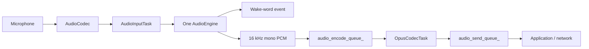

# Audio Service Architecture

`AudioService` owns one input engine and keeps codec I/O, Opus encoding/decoding,
and network queues independent from the chip-specific speech pipeline.

## Input engines

The old `AudioProcessor + WakeWord` combinations have been replaced by a single
`AudioEngine` interface. `AudioInputTask` reads PCM once and feeds exactly one
engine.

| Target | Engine | Wake word | Uplink processing |
| --- | --- | --- | --- |
| ESP32-S3 / ESP32-P4 / ESP32-S31 | `AfeAudioEngine` | WakeNet inside AFE, or MultiNet fed from AFE output | FD AEC + VAD when audio processing is enabled |
| ESP32 / ESP32-C3 / ESP32-C5 / ESP32-C6 | `LiteAudioEngine` | Standalone WakeNet when configured | Raw mono PCM |

`AfeAudioEngine` owns a single FD AFE instance. WakeNet and voice uplink share
that instance, so enabling both no longer creates two AFE pipelines. For custom
MultiNet wake words, AFE fetch output is passed to `CustomWakeWord`; MultiNet is
not created on the smaller targets.

`AudioService::GetWakeWords()` returns the phrases supported by the initialized
engine, independently of the last detected phrase. WakeNet lists only active
models; MultiNet lists the display text of commands with the `wake` action.
After successful startup, the first idle state enables wake-word detection and
shows these phrases in an assistant chat message after idle UI cleanup. The
message is removed after five seconds on OLED and LCD displays. The timeout only
removes the matching hint, preserving newer messages and alerts. Disabled or failed
wake-word detection and startup errors suppress the hint; subsequent idle transitions
do not repeat it.

The AFE configuration uses `FD_LOW_COST` AEC with `AEC_NLP_LEVEL_AGGR`.
`CONFIG_WAVESHARE_3_5B_AEC_NS` enables single-channel noise suppression through
`ns_init`; microphone-array SE stays disabled. The Waveshare 3.5B variant selects
NSNet2, with its model packaged alongside WakeNet in `srmodels.bin`, including
custom and Emote asset packs. Selecting the WebRTC backend uses the built-in NS
without a model. AGC remains disabled. Check the printed AFE pipeline and real
recordings before judging suppression quality.

For ES8311, the official input-gain API changes ADC digital scale in register
`0x16` (6 dB steps); analog PGA is separately controlled by `0x14[3:0]` (3 dB
steps). Waveshare's 24 dB input setting leaves the driver's analog PGA at 30 dB.
Raw codec PCM precedes software NS and can still contain microphone noise;
listen to `aec_out` or uplink PCM to evaluate the processed signal.

When wake-word audio upload is enabled, the most recent two seconds of PCM are
stored in a single 64 KB PSRAM ring buffer. WakeNet and MultiNet share the same
cache implementation, and the encoder reads it one Opus frame at a time. This
avoids the previous per-chunk internal-SRAM allocations and temporary PCM
concatenation buffer.

## Input data flow

### Board input layouts

Built-in boards default to one microphone: `M` without a playback reference, or
`MR` when the codec supplies a playback reference. `R` must contain playback
reference samples, not a second microphone. The channel declaration must match
the interleaved PCM returned by the codec.

Waveshare 3.5B selects `CONFIG_WAVESHARE_3_5B_ES8311_REFERENCE` by default.
ES8311 supplies ADC microphone samples in the left slot and its internal DAC
digital reference in the right slot. Both channels are resampled together from
24 kHz to 16 kHz and fed as `MR`. The shared codec device uses stereo I/O, so
mono playback samples are duplicated into the two TX slots while preserving
playback duration. This reference precedes the amplifier and speaker; it does
not capture their nonlinear distortion. Disabling the option restores the
software playback reference. Other boards keep the codec's default mono input.

Multiple-microphone input remains available for developer experiments; the AFE
still derives its format from the codec's microphone and reference counts.
For Box Lite, the final `BoxAudioCodecLite` constructor parameter is
`microphone_channels`, defaulting to `1`. Pass `2` explicitly to test `MMR`
with reference enabled, or `MM` without it. `EnableInput()` and `Read()` use this
count for capture and interleaving. On ESP32-S31-Korvo-1, developers can change
the board's `AUDIO_INPUT_CHANNELS` from `1` to `2` to test `MM`; its codec has no
playback reference. Neither experimental layout is enabled in default builds.

Single-microphone defaults do not imply that ESP-SR FD lacks dual-microphone
support, or guarantee hardware operation. Validate capture, playback, wake/VAD,
interruption, reconnect, and applicable AEC modes on the affected board before
releasing a change. Box Lite's software playback reference also needs timing
and concurrency validation.

Wake-word detection and voice processing are independent runtime states on the
same engine. On AFE targets, AEC stays active while wake-word detection is active
so playback reference remains available for wake-up during device playback. It
also stays active during voice processing when device AEC is requested.

Conversation mode selection can override that default: Manual and Auto disable
device AEC; Realtime keeps microphone processing and uplink active during reply
playback. The playback-only policy arms AEC when audio enters the playback queue,
renews it for actual codec writes, and keeps a provisional 300 ms DMA/acoustic
tail before bypassing. Controls run on the AFE fetch task without recreating the
engine. Tail length and the effect of re-enabling AEC require board validation.
`EnableAecMonitoring()` retains continuous AEC for deterministic diagnostics.

Enabling already-active voice processing is idempotent: switching the UI between
Listening and Speaking must not reset the playback or input resampler. A new
capture session invalidates queued/in-flight uploads from the previous session.
Playback cancellation retains the reference for samples already submitted to DMA
and rejects queued/in-flight old audio; codec writes are split into 20 ms chunks.
This bounds a pending software write, not the complete acoustic stop latency.

## Output data flow

## Tasks and power management

- `AudioInputTask` reads codec input and feeds the selected engine.
- `AudioOutputTask` drains decoded PCM to the codec output.
- `OpusCodecTask` encodes uplink PCM and decodes downlink packets.
- `AfeAudioEngine` has its own AFE fetch task on S3/P4/S31.

The audio power timer still enables and disables codec ADC/DAC channels based on
activity; the engine refactor does not change that policy.

## Queue and allocation policy

The service queues use compile-time fixed-capacity storage. Their existing drop,
wait, and playback-drain policies remain unchanged, but queue growth no longer
allocates deque nodes. `AudioTask` values are stored directly, and Opus encoding
writes into the packet payload instead of allocating a second temporary output
buffer. Packet and PCM buffer pools should only be added after target-side heap
and latency measurements justify their additional ownership complexity.
